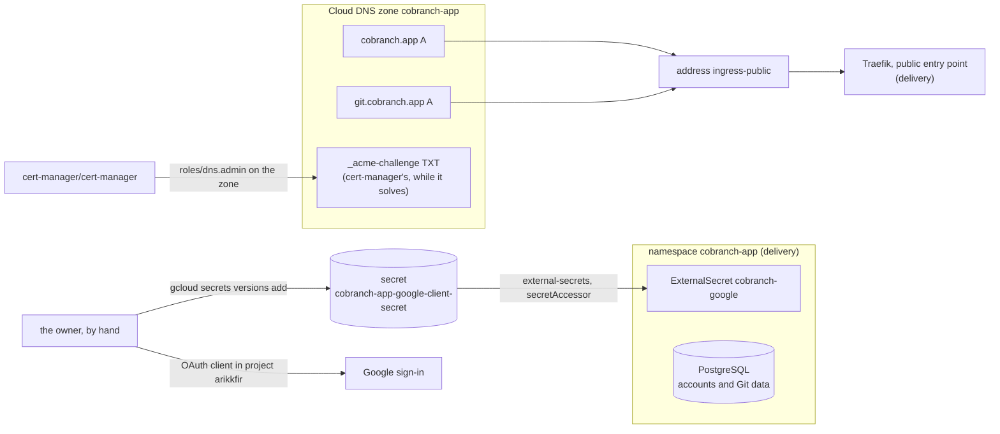
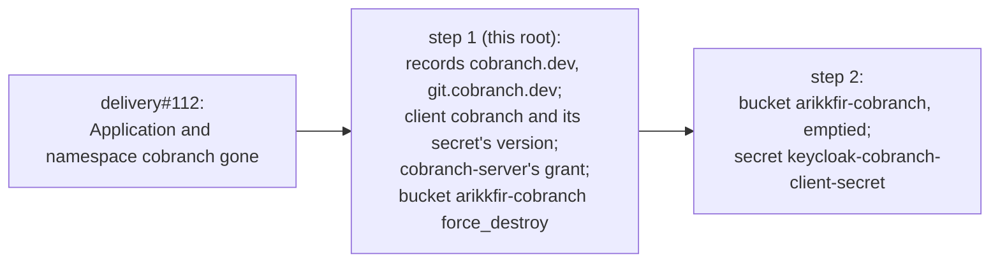

# cobranch.app in GCP

**Decision**: `cobranch.app`, Cobranch's hosted service, runs on the hub's cluster from Cobranch's `main`, open to anyone who signs up. This root gives it what a public installation needs from Google Cloud: the apex and `git.cobranch.app` on the public gateway's address, cert-manager's grant on zone `cobranch-app` for their certificate, and the container for its Google sign-in client's secret. It needs no bucket: the owner decided that Cobranch keeps Git data in its own PostgreSQL by default, and that no installation of ours is to use a bucket (2026-11-01). Cobranch's `main` still requires a bucket until [ENG-237](https://linear.app/arikkfir/issue/ENG-237) makes PostgreSQL the default, so `delivery` deploys `cobranch.app` only once it has. The Google client itself is the owner's to make by hand, in project `arikkfir`, since Google Cloud has no API for it ([below](#manual-steps)). What runs in the cluster, its routes and its sign-in values are `delivery`'s. Linear: [ENG-232](https://linear.app/arikkfir/issue/ENG-232).

## Design

| Resource | File | Name |
| --- | --- | --- |
| Records | `dns.tf`, `google_dns_record_set.cobranch_app` | `cobranch.app` and `git.cobranch.app`, A, 300 seconds, the address `ingress-public` |
| Zone grant | `iam.tf`, `google_dns_managed_zone_iam_member.cert_manager` | `roles/dns.admin` on zone `cobranch-app` to `cert-manager/cert-manager` |
| Secret | `secrets.tf` | `cobranch-app-google-client-secret`, which External Secrets reads, as it reads every non-pipeline secret |

The facts themselves, every name and grant, are in [root gcp](../terraform/gcp.md): its [Secret Manager](../terraform/gcp.md#secret-manager), [IAM](../terraform/gcp.md#iam) and [DNS](../terraform/gcp.md#dns).

## Manual steps

Google Cloud makes the OAuth clients that Google sign-in uses only in its console, so the owner makes `cobranch.app`'s by hand, once, in project `arikkfir`, beside the hub's own Google client. People signing in see that project's consent screen.

1. In project `arikkfir`, open Google Auth Platform. Under **Branding**, add `cobranch.app` to the authorized domains.
2. Under **Audience**, check that the user type is External and the publishing status is In production: an app in Testing admits only its listed test users. Its only scopes, `openid`, `email` and `profile`, need no review by Google.
3. Under **Clients**, create a Web application client named `cobranch.app` with authorized redirect URI `https://cobranch.app/auth/callback`.
4. Add the client's secret: `gcloud secrets versions add cobranch-app-google-client-secret --project arikkfir --data-file=-`, then paste it and press Ctrl-D. The client ID is not secret: it goes into `delivery`'s values for `cobranch.app`.

If Google asks to verify a domain, its TXT record goes into that domain's zone through this repository: `cobranch-app` for `cobranch.app`, `cobranch-dev` for `cobranch.dev`.

## Decisions

| Decision | Why | Rejected |
| --- | --- | --- |
| Both names on the public gateway | Anyone signs up and signs in to `cobranch.app`, and Git clients can't pass the hub's sign-in, whose cookie covers `kfirs.com` only anyway | The protected gateway |
| `git.cobranch.app`, a name of its own | The Console owns every path of the apex; Git's paths (`/<organization>/<repository>.git`) can't be told apart from the Console's by prefix | Git under a path of the apex, such as `/git` |
| No bucket | Cobranch's default, from [ENG-237](https://linear.app/arikkfir/issue/ENG-237) on, keeps Git data in its PostgreSQL; a bucket stays a supported option of the product, which no installation of ours is to use (owner, 2026-11-01) | Bucket `arikkfir-cobranch-app`, which this root made first and removed before anything used it |
| No backups yet | The owner's call at launch (2026-11-01): the database's volume is its only copy | A nightly `pg_dump` to a bucket the dump could only add to; Backup for GKE |
| The Google client in project `arikkfir`, made by hand | Google offers no API for OAuth clients; the owner chose the hub's project over one of Cobranch's own (2026-11-01) | A project of its own, whose consent screen would name Cobranch |

## Security and failure modes

- **The client's secret** never enters Git or Terraform's state: the owner adds it to the container, and only External Secrets reads it. A leaked secret lets someone run a sign-in as `cobranch.app` only to its registered redirect URI; the owner rotates it in the Cloud console and adds a new version.
- **Losing the database's volume** loses every user's data, Git repositories included: nothing backs it up yet.

## Rollout

1. [infra#105](https://github.com/arikkfir-org/infra/pull/105), applied by pipeline `apply` on merge: the records, the grant, the secret's container, and two buckets.
2. This repository's next pull request removes both buckets and their grants, before anything used them: Git data lives in the database, and the owner chose no backups yet.
3. Cobranch: PostgreSQL becomes the default for Git data, and the chart's `blob.url` optional ([ENG-237](https://linear.app/arikkfir/issue/ENG-237)). Until then `cobranch.app` can't start without a bucket.
4. The owner makes the Google client and adds its secret ([above](#manual-steps)).
5. `delivery`: `cobranch.app`'s environment, once ENG-237 is on Cobranch's `main`.
6. `delivery` takes the demo down, its data with it ([delivery#112](https://github.com/arikkfir-org/delivery/pull/112)); then this repository removes what only the demo used ([infra#107](https://github.com/arikkfir-org/infra/pull/107), [below](#the-demos-removal)).
7. This repository deletes bucket `arikkfir-cobranch`, emptied, and secret `keycloak-cobranch-client-secret`, once the previous step is applied. That closes [ENG-232](https://linear.app/arikkfir/issue/ENG-232).

## The demo's removal

`cobranch.app` replaced Cobranch's demo at `cobranch.dev.kfirs.com` ([hosting Cobranch's demo](../../delivery/designs/cobranch.md)), and the owner took the demo down, its data with it, once `cobranch.app` answered and their first push to it worked (2026-11-02). What only the demo used goes in two changes, after `delivery`'s, so that no route is left pointing at a missing host:

| Removed | Root | Step |
| --- | --- | --- |
| Records `cobranch.dev` and `git.cobranch.dev` under `kfirs.com`; the previews keep `*.cobranch.dev` and `*.git.cobranch.dev` | `gcp` | 1 |
| Keycloak client `cobranch` and the version of its secret it wrote | `keycloak` | 1 |
| `cobranch/cobranch-server`'s `roles/storage.objectUser` on the bucket | `gcp` | 1 |
| Bucket `arikkfir-cobranch`, which still holds the demo's Git packs | `gcp` | 2 |
| Secret `keycloak-cobranch-client-secret`, with External Secrets' grant on it | `gcp` | 2 |

| Decision | Why | Rejected |
| --- | --- | --- |
| Two steps for the bucket | Terraform deletes a bucket with objects only when `force_destroy` is already true in its state, so the flag is applied first | One change, which fails at the bucket and leaves the apply half done; emptying it by hand |
| The secret after the client | Pipeline `apply` runs `keycloak` after `gcp`, so deleting the secret in the same change would leave `keycloak` destroying a version of a secret already gone | Deleting both at once |
