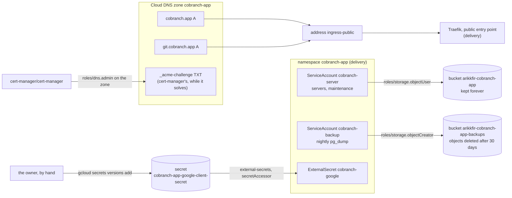

# cobranch.app in GCP

**Decision**: `cobranch.app`, Cobranch's hosted service, runs on the hub's cluster from Cobranch's `main`, open to anyone who signs up. This root gives it what a public installation needs from Google Cloud: the apex and `git.cobranch.app` on the public gateway's address, cert-manager's grant on zone `cobranch-app` for their certificate, a bucket of its own for its users' objects, a backups bucket its nightly database dump can only add to, and the container for its Google sign-in client's secret. The client itself is the owner's to make by hand, since Google Cloud has no API for it ([below](#manual-steps)). What runs in the cluster, its routes and its sign-in values are `delivery`'s. Linear: [ENG-232](https://linear.app/arikkfir/issue/ENG-232).

## Design

| Resource | File | Name |
| --- | --- | --- |
| Records | `dns.tf`, `google_dns_record_set.cobranch_app` | `cobranch.app` and `git.cobranch.app`, A, 300 seconds, the address `ingress-public` |
| Zone grant | `iam.tf`, `google_dns_managed_zone_iam_member.cert_manager` | `roles/dns.admin` on zone `cobranch-app` to `cert-manager/cert-manager` |
| Buckets | `storage.tf` | `arikkfir-cobranch-app` (kept), `arikkfir-cobranch-app-backups` (30 days) |
| Bucket grants | `iam.tf`, `local.bucket_iam` | `roles/storage.objectUser` to `cobranch-app/cobranch-server`; `roles/storage.objectCreator` to `cobranch-app/cobranch-backup` |
| Secret | `secrets.tf` | `cobranch-app-google-client-secret`, which External Secrets reads, as it reads every non-pipeline secret |

The facts themselves, every name and grant, are in [root gcp](../terraform/gcp.md): its [buckets](../terraform/gcp.md#buckets), [Secret Manager](../terraform/gcp.md#secret-manager), [IAM](../terraform/gcp.md#iam) and [DNS](../terraform/gcp.md#dns).

## Manual steps

Google Cloud makes the OAuth clients that Google sign-in uses only in its console, so the owner makes `cobranch.app`'s by hand, once, in a project of its own: a project's consent screen names one app, and project `arikkfir`'s already signs people in to the hub.

1. Create project `Cobranch` at `https://console.cloud.google.com/projectcreate`. It needs no billing account.
2. In it, open Google Auth Platform. Under **Branding**, set app name `Cobranch`, the support email, home page `https://cobranch.dev`, and authorized domains `cobranch.app` and `cobranch.dev`. Under **Audience**, choose External and publish the app. Its only scopes, `openid`, `email` and `profile`, need no review by Google.
3. Under **Clients**, create a Web application client named `cobranch.app` with authorized redirect URI `https://cobranch.app/auth/callback`.
4. Once this root's apply has made the container, add the client's secret: `gcloud secrets versions add cobranch-app-google-client-secret --project arikkfir --data-file=-`, then paste it and press Ctrl-D. The client ID is not secret: it goes into `delivery`'s values for `cobranch.app`.

If Google asks to verify a domain, its TXT record goes into zone `cobranch-app` through this repository.

## Decisions

| Decision | Why | Rejected |
| --- | --- | --- |
| Both names on the public gateway | Anyone signs up and signs in to `cobranch.app`, and Git clients can't pass the hub's sign-in, whose cookie covers `kfirs.com` only anyway | The protected gateway |
| `git.cobranch.app`, a name of its own | The Console owns every path of the apex; Git's paths (`/<organization>/<repository>.git`) can't be told apart from the Console's by prefix | Git under a path of the apex, such as `/git` |
| A bucket of its own, `arikkfir-cobranch-app` | `cobranch.app` starts empty, apart from the demo, which goes away with its bucket | Reusing `arikkfir-cobranch` |
| Dumps in a bucket the dump can only add to | A dump job that is compromised, or a bug in it, can't erase the backups it would be needed to restore from; lifecycle deletes them after 30 days | `roles/storage.objectUser`; Backup for GKE, which needs a cluster add-on, an API and a role for the pipelines |
| The Google client in a project of its own, made by hand | Google offers no API for OAuth clients, and the consent screen's name belongs to its project | A client in project `arikkfir`, whose consent screen is the hub's |

## Security and failure modes

- **The client's secret** never enters Git or Terraform's state: the owner adds it to the container, and only External Secrets reads it. A leaked secret lets someone run a sign-in as `cobranch.app` only to its registered redirect URI; the owner rotates it in the Cloud console and adds a new version.
- **The buckets** prevent public access. Only `cobranch.app`'s servers and maintenance job reach its data bucket; nothing in the cluster reads the backups, which the owner restores from by hand.
- **Losing the data bucket's objects.** Cloud Storage's soft delete keeps deleted objects for 7 days, its default, so a pack deleted by mistake can be restored within that time.

## Rollout

1. This pull request, applied by pipeline `apply` on merge: the records, the grant, the buckets, their grants and the secret's container. Nothing answers at `cobranch.app` until `delivery` serves it.
2. The owner makes the Google client and adds its secret ([above](#manual-steps)).
3. `delivery`: `cobranch.app`'s environment.
