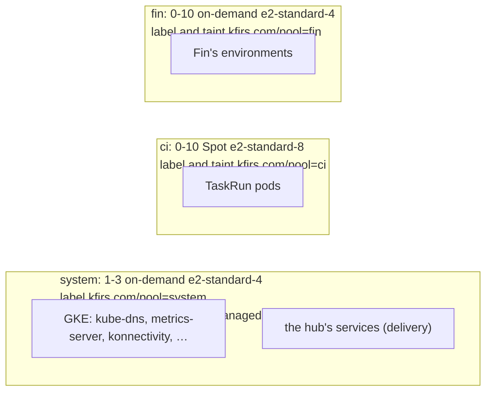

# Node pools

**Decision**: The cluster runs three node pools, each tainted so that only its own workloads run there. `system` (1 to 3
on-demand `e2-standard-4`) runs the hub's services beside GKE's own components, under GKE's taint for those components.
`ci` (0 to 10 Spot `e2-standard-8`) runs CI. `fin` (0 to 10 on-demand `e2-standard-4`) runs Fin's environments.
Pull requests: arikkfir-org/infra (the `fin` pool and `octomaton-logs`' grants; Spot CI; the system pool's taint), and
the workloads' side in `delivery` ([node pools](../../delivery/designs/node-pools.md)) and `fin`.

## Why

- On 12 October the cluster ran on one `e2-standard-4` node: the hub's services, production and four pull requests'
  environments. Their end-to-end suites held it at 85 to 110% CPU, sign-ins to Keycloak timed out and NATS lost its
  stream leaders, and the suites failed on what they had caused.
- The system pool had no taint, so every pod that selected no pool landed on it, and the `optimize-utilization`
  profile packs pods onto the fullest node ([node autoscaling](node-autoscaling.md)).
- The Tekton Dashboard can't show a step's log once its CI node is gone, about a minute after the node's last pod ends.
  `octomaton-logs` reads those logs from Cloud Logging, as its own identity.

## Design

The pools, as the three pull requests left them ([root gcp](../terraform/gcp.md#node-pools)):

| Pool | Machine | VMs | Nodes | Label | Taint (`NoSchedule`) | Who tolerates it |
| --- | --- | --- | --- | --- | --- | --- |
| `system` | `e2-standard-4` | on-demand | 1-3 | `kfirs.com/pool=system` | `components.gke.io/gke-managed-components=true` | GKE's managed components; the hub's services (delivery) |
| `ci` | `e2-standard-8` | Spot | 0-10 | `kfirs.com/pool=ci` | `kfirs.com/pool=ci` | TaskRun pods, through Tekton's default pod template (delivery) |
| `fin` | `e2-standard-4` | on-demand | 0-10 | `kfirs.com/pool=fin` | `kfirs.com/pool=fin` | Fin's pods (`deploy/` in `fin`); delivery's policy `fin-node-pool` lets them tolerate nothing else |

GKE's own DaemonSets tolerate every taint, so each pool keeps its logging, metrics and networking agents.

`octomaton-logs` (namespace `octomaton`) reads logs as its Kubernetes ServiceAccount's principal: `roles/logging.viewAccessor`
on the project, conditioned on the `_Default` bucket's `_Default` view, and the telemetry roles Octomaton's server has.

## Decisions

| Decision | Why | Rejected |
| --- | --- | --- |
| The system pool takes GKE's managed-components taint | kube-dns, metrics-server, konnectivity and GKE's other Deployments tolerate it and nothing of ours; GKE documents it for a pool of its components. With a taint of our own on every pool they'd have no node | A taint of our own and a fourth, untainted pool for GKE; `PreferNoSchedule`, which keeps nothing off; no taint, as before |
| Fin's own pool | Its environments, five or six at a time with their suites, outgrow a node, and production should never wait on the hub's services nor they on it | More system nodes, which the profile would pack together again; a pool per kind of environment (Fin keeps production and pull requests on separate nodes with one anti-affinity rule instead) |
| `fin` on-demand `e2-standard-4`, 0 to 10 | Production always runs, so a preempted node would take it down. A pull request's environment requests up to its quota's 2 CPUs, three scrapes included, so a node holds one or two of them | Spot, for production; `e2-standard-8`, whose empty node costs twice as much |
| `ci` on Spot again, up to 10 nodes | The owner's choice. Spot VMs cost a fraction of on-demand ones, and a CI run survives a lost node better than production does: its tasks can retry | On-demand, as since arikkfir-org/infra#20 (risks below) |
| `octomaton-logs` reads through the `_Default` view, by an IAM condition on a project grant | Narrower than `roles/logging.viewer`: no `_Required` bucket, no Data Access logs, no logging configuration, and it answers for CI's namespaces only. Its pipeline grants need nothing new | A view of CI's logs alone, which pipeline `apply` can't create without a logging role and `ci`'s plans can't read without one that reads every log; a grant on the view's own policy, which takes `logging.admin` |

## Risks

- Spot capacity in `me-west1` ran out often enough on 1 October to preempt most CI runs, which is why the pool went
  on-demand (arikkfir-org/infra#20). A preempted node kills its pods: a task without `retries` fails its run.
- An empty pool costs nothing, but `fin` always has production's node, and a second one whenever a pull request is open:
  two to four nodes run where one did.
- A hub service that doesn't tolerate the system pool's taint, or a GKE component that one day doesn't, waits for a node.

## Rollout

1. The `fin` pool and `octomaton-logs`' grants: pipeline `apply` on merge. Nothing runs there until `fin` selects it.
2. The `ci` pool on Spot, up to 10 nodes. Spot replaces the pool, the node that runs pipeline `apply` included, so the
   owner applies it as arikkfir-org/infra#61 was: while no CI runs, merge `main` into its branch, apply `gcp` from it
   (`make terraform gcp`), and merge it straight away. Runs in flight lose their pods.
3. `fin` moves its environments to the pool; `delivery` puts the hub's services on the system pool and holds Fin's pods
   to theirs.
4. The system pool's taint, once both are synced: pipeline `apply` updates the pool's nodes in place, and running pods
   stay. Anything still without the toleration waits for a node when it next restarts.

Roll back in reverse. Reverting the taint first frees every pod to land on the system pool again.
