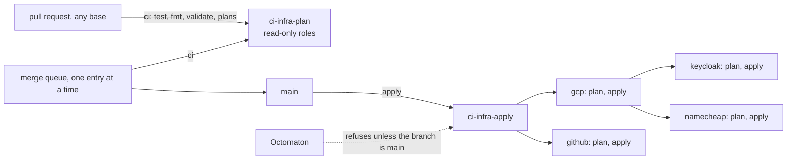

# Terraform plan on pull requests, apply on merge

**Decision**: `infra` plans `gcp`, `github`, `keycloak` and `namecheap` on every pull request and in the merge queue, and applies whatever the plans say when a change merges to `main`, through Octomaton. Two Kubernetes ServiceAccounts in tenant `ci-infra` hold the roles: `ci-infra-plan`, which only reads, and `ci-infra-apply`, which Octomaton lets only runs from `main` use (annotation `octomaton.dev/branches: main`). The merge queue takes one pull request at a time, so the plan a merge was reviewed with is the plan that is applied. `argocd` stays by hand. What each root provisions: [gcp](../terraform/gcp.md), [github](../terraform/github.md), [keycloak](../terraform/keycloak.md), [namecheap](../terraform/namecheap.md), [argocd](../terraform/argocd.md).

## Why

- Before, the owner ran `make terraform <root>`, read the plan and applied it, and the code on `main` could drift from what ran.
- A run's PipelineRun file comes from the commit under test, so a pull request's run can name any ServiceAccount in its namespace, and even an unchanged `terraform plan` runs the pull request's code (`data "external"`).
- A GKE identity says which namespace and ServiceAccount a pod runs as, never which branch. Only Octomaton knows the branch, so only Octomaton can keep the identity that applies away from unmerged code ([Octomaton's tenancy and identity](../../octomaton/designs/phase-2-octomaton.md#tenancy-and-identity)).

## Design

### Pipelines

| Pipeline (check) | Triggers | ServiceAccount | Tasks |
| --- | --- | --- | --- |
| `ci` (`Continuous Integration`) | `pull_request` (every pull request, whatever its base), `merge_group` | `ci-infra-plan` | `check`: the unit tests of `.tekton/plan-summary.py`, `terraform fmt -check -recursive`, and `init -backend=false` and `validate` in all five roots. `gcp`, `github`, `keycloak`, `namecheap`: a full `init`, which reads the state in `arikkfir-devops`, then `plan -lock=false -out`, `keycloak` with `-refresh=false`, then the summary. All five tasks at once |
| `apply` (`Apply`) | `push` to `main` | `ci-infra-apply` | `gcp`, `github`, `keycloak`, `namecheap`: a full `init`, `plan -out`, the summary, and `apply` of the saved plan, deletions and replacements included. `gcp` and `github` at once; `keycloak` and `namecheap` after `gcp`, which creates the secrets `keycloak` writes and the zones `namecheap` reads |

- Every task is its own pod, which clones the commit into its own `emptyDir`, requests 500m of CPU and 1Gi of memory (2Gi limit), and keeps Terraform's provider cache in a volume its steps share.
- The PipelineRuns, `.tekton/ci.yaml` and `.tekton/apply.yaml`, reference their tasks by name: `check.task.yaml`, `plan.task.yaml` (each root's task in `ci`) and `apply.task.yaml` (each root's in `apply`), whose shared steps are StepActions (`clone.step.yaml`, `credentials.step.yaml`, `summary.step.yaml`) and whose scripts are in `.tekton/scripts/`. Octomaton inlines the files into the run it creates.
- Each task is also its own check (`taskChecks`): `Continuous Integration / gcp`, `Apply / keycloak` and so on. A root's check keeps its plan when another root fails, where the run's check, whose result names every task's, has none.
- `.tekton/plan-summary.py` turns the plans into the check's title and summary: changes, deletions and replacements first, cut to fit Tekton's termination messages (a long list is cut short; the task's log has it all).
- Plans never take the state lock: `ci-infra-plan` can't write the state, and a plan changes nothing. Applies wait up to 10 minutes for it.
- Concurrency: the merge queue's runs and `apply` share group `terraform`, policy `queue`, so each queue entry is planned after the previous merge has been applied. A pull request's runs queue in a group of their own, `pr-<number>`.
- A failed root stops no task already running, but no task starts after a failure: `github` can be applied while `gcp` fails, and neither `keycloak` nor `namecheap` applies after `gcp` failed.
- `argocd` is never planned or applied by a pipeline: it bootstraps Argo CD, which manages itself afterwards.

### Identities

Both are ServiceAccounts in `ci-infra`, made by `delivery`, granted through Workload Identity Federation principals, with no Google service accounts.

| ServiceAccount | Annotation | GCP roles (each one: [IAM](../terraform/gcp.md#iam)) | Keycloak client (realm `master`) |
| --- | --- | --- | --- |
| `ci-infra-plan` | none | Viewer and reader roles on the project, `roles/iam.securityReviewer` included; each bucket's settings; the state in `arikkfir-devops`; secrets `infra-plan-github-pat`, `infra-plan-keycloak-secret`, `infra-namecheap-api-user` and `infra-namecheap-api-key` | `terraform-plan`, secret `infra-plan-keycloak-secret`: view roles only |
| `ci-infra-apply` | `octomaton.dev/branches: main` | An admin role per resource type on the project, `roles/iam.securityAdmin` included; `roles/iam.serviceAccountUser` on `gke-hub-nodes@` | `terraform-apply`, secret `infra-apply-keycloak-secret`: realm role `admin` |

The roles cover each resource type in `terraform/gcp`. Each admin role also sets the IAM policies of its own resources: `roles/storage.admin` the buckets', `roles/secretmanager.admin` the secrets' and `roles/artifactregistry.admin` the repositories'. `roles/iam.securityAdmin` sets the project's and the DNS zones', which `roles/dns.admin` can't. GCP grants `roles/owner` only to Google accounts, groups and service accounts, never to a federated principal. The Keycloak clients and why plans of `keycloak` don't refresh: [root keycloak](../terraform/keycloak.md#pull-request-plans-dont-refresh).

### GitHub tokens

| Secret Manager secret | Token (fine-grained, resource owner `arikkfir-org`, all repositories) | Read by |
| --- | --- | --- |
| `infra-plan-github-pat` | Repository Administration, Metadata and Pull requests: read, Contents: read and write; organization Administration and Members: read | `ci-infra-plan` |
| `infra-apply-github-pat` | Repository Administration, Contents and Pull requests: read and write, Metadata: read; organization Administration and Members: read and write | `ci-infra-apply` (through `roles/secretmanager.admin`) |

Both have Contents read and write because GitHub shows a repository's merge settings (merge methods, auto-merge, branch updates and deletion, commit titles and messages) only to tokens that have it. Without it, the provider reads them as unset, so every plan shows every repository changed, and an apply stores the wrong values. Pull requests is for the repositories' labels, which GitHub's API serves under Issues or Pull requests; the repositories have issues off.

The owner creates both GitHub tokens, adds them with `gcloud secrets versions add`, and renews them within a year; [root keycloak](../terraform/keycloak.md) generates the Keycloak secrets.

### Credentials

A task's `credentials` step (`.tekton/scripts/credentials.sh`) reads its own root's credentials, and no other root's, with `gcloud secrets versions access` into a memory volume only that task's steps share:

| Root | Secrets | Environment (`.tekton/scripts/terraform.sh`) |
| --- | --- | --- |
| `gcp` | none: its provider authenticates as the task's ServiceAccount | |
| `github` | `infra-plan-github-pat` or `infra-apply-github-pat` | `GITHUB_TOKEN` |
| `keycloak` | `infra-plan-keycloak-secret` or `infra-apply-keycloak-secret` | `KEYCLOAK_CLIENT_SECRET`, beside `KEYCLOAK_CLIENT_ID` (`terraform-plan` or `terraform-apply`) |
| `namecheap` | `infra-namecheap-api-user` and `infra-namecheap-api-key`, the same for plans and applies | `NAMECHEAP_USER_NAME`, `NAMECHEAP_API_USER` and `NAMECHEAP_API_KEY` ([root namecheap](../terraform/namecheap.md)) |

No Kubernetes Secret holds them: Octomaton never lets a `push` pipeline mount one.

### By hand

`make terraform <root>` (the README): `argocd`; `keycloak`'s first apply, as the bootstrap admin; and a change to the pipelines' own roles or tokens, which they can't apply to themselves. Such a role goes in a pull request of its own, which the owner applies before the change that needs it (`CLAUDE.md`).

## Decisions

| Decision | Why | Rejected |
| --- | --- | --- |
| The branch restriction lives on the ServiceAccount, in `delivery` | Only Octomaton knows a run's branch, and a pull request to `infra` can't change `delivery` | A list in `.octomaton.yaml` (a pull request edits it); a branch condition on the principal (GKE identities carry none); a namespace for runs from `main` (Octomaton gives a repository one namespace); roles on the shared `pipeline` ServiceAccount (any pull request could apply) |
| Two identities, plan and apply | Pull requests still get plans, which can't change GCP, Keycloak or any GitHub setting | Plans only after merging |
| Predefined roles | `roles/owner` can't be granted to a federated principal | `roles/owner` |
| Credentials read from Secret Manager at run time | Octomaton refuses Secrets in `push` pipelines | Kubernetes Secrets, which would need that rule relaxed |
| Apply every plan in full, deletions and replacements included | The pull request's plan is the review, and merging approves it. `prevent_destroy` still fails any plan that would destroy a DNS zone, the organization's settings, a repository, realm `hub` or `claude-code@` | Stopping on any deletion or replacement for the owner to apply by hand, the first version (until arikkfir-org/infra#28); it stopped even on IAM bindings a reviewed pull request removed |
| A merge queue of one, sharing a concurrency group with `apply` | The plan of each merge is the plan that is applied | Groups of up to five |
| A task per root, in parallel; `keycloak` and `namecheap` after `gcp` | The roots share no state, so their plans and applies don't wait on each other, except `keycloak`'s writes into `gcp`'s secrets and `namecheap`'s reads of `gcp`'s zones. Each task clones into its own `emptyDir`: without the affinity assistant, tasks sharing a volume must run one after another. Each task is its own check, which keeps its root's plan when another root fails: Tekton drops a pipeline result that names a failed task's result | One task planning, then applying, every root in turn (until arikkfir-org/infra#39); a volume shared by the tasks; Tekton's `matrix`, whose TaskRuns share one pipeline task name, so Octomaton's task table and checks show only one of them |
| Contents read and write on both tokens | GitHub shows merge settings only to such tokens, and pull request plans of `github` still refresh, so they show drift | A plan token without it and `-refresh=false` for `github` (no drift in pull request plans); `ignore_changes` on the merge settings (Terraform would set them only at creation) |
| Pull requests of every base branch are checked | A pull request stacked on another branch is planned before it reaches `main` | `pull_request` to `main` only, as at first |
| Each task reads only its own root's credentials | A task holds no credential its root doesn't use: `gcp`'s holds none, and only `namecheap`'s holds the Namecheap key | Every task reading the GitHub token and the Keycloak secret, until [ENG-222](https://linear.app/arikkfir/issue/ENG-222) |
| Tasks and shared steps in files beside the PipelineRuns, scripts in `.tekton/scripts/` | Tekton files stay short and composed from references (`CLAUDE.md`), and scripts in files can be linted and run alone | One inline `taskSpec` per pipeline, shared through a YAML anchor, with inline scripts, until [ENG-222](https://linear.app/arikkfir/issue/ENG-222) |

## Security and failure modes

- A pull request can run any code as `ci-infra-plan`: it can read the project's configuration and IAM policies, Terraform's state, Keycloak's realms and clients, the plan token and the Namecheap API key. It can't change GCP, Keycloak or any GitHub setting, but the token's Contents write lets it push branches and tags and manage releases in every repository; the `Default branch` ruleset keeps it off default branches. Namecheap has no read-only API key, so the plans' key can change or transfer every domain of the account; plans hold it anyway, since only `infra`'s own branches get pull request runs (Octomaton ignores forks). Dependabot's are among them, so a compromised provider version that a pull request installs could use the token and the key too.
- Only a merge to `main` runs as `ci-infra-apply`. Its roles include `roles/iam.securityAdmin`, so it could grant itself more: the review and the merge are the gate.
- Octomaton is the only workload that creates pods in `ci-infra` (RoleBinding `octomaton`), so it is the only path to `ci-infra-apply`. Cluster admins can always bypass it.
- A merge applies its plan in full, deletions and replacements included. The pull request's `Continuous Integration` check lists them first: read it before merging.
- An apply that fails part-way leaves what it applied; the next merge, or the owner, finishes. A refused run (wrong branch) fails the `Apply` check with the reason. Missing roles show up as a failed plan or apply, never as a wrong change, but a missing write permission plans green and fails partway through the apply (`CLAUDE.md`).
- A root's first `init` writes its empty state, which `ci-infra-plan` can't: every plan of a root that only the pipelines apply fails until the owner runs `terraform -chdir=terraform/<root> init` once ([root namecheap](../terraform/namecheap.md#running-it-by-hand)).
- With Keycloak down, every pull request's `Continuous Integration` fails on its `keycloak` task ([root keycloak](../terraform/keycloak.md#security-and-failure-modes)), and with Namecheap's API down, or address `egress` off its allow-list, on its `namecheap` task ([root namecheap](../terraform/namecheap.md#security-and-failure-modes)).

## History

Built in arikkfir-org/octomaton#15 (the ServiceAccount branch check), `delivery`'s two ServiceAccounts, and arikkfir-org/infra's roles, secrets, serial merge queue and pipelines; `keycloak` joined the pipelines with ENG-58, and `namecheap` with [ENG-222](https://linear.app/arikkfir/issue/ENG-222), which also split the PipelineRuns into Task and StepAction files and gave each task only its own root's credentials. The same restriction then covered the publishing pipelines of `docs`, `tooling` and `octomaton` ([Octomaton's tenancy and identity](../../octomaton/designs/phase-2-octomaton.md#tenancy-and-identity)).
