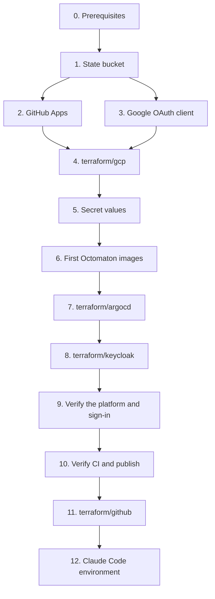

# Bootstrap runbook

Bringing the hub up from nothing, in order. Every step can run again. What each Terraform root makes: [gcp](../terraform/gcp.md), [argocd](../terraform/argocd.md), [github](../terraform/github.md), [keycloak](../terraform/keycloak.md). Designs: [Octomaton](../../octomaton/designs/phase-2-octomaton.md), [ingress and authentication](../../delivery/designs/phase-3-ingress-and-auth.md), Fin's [environments](../../fin/designs/environments.md).



## 0. Prerequisites

- `gcloud` signed in as a project owner of `arikkfir`, with Application Default Credentials: `gcloud auth login && gcloud auth application-default login`.
- Terraform 1.14 or later, `kubectl`, Go and [`ko`](https://ko.build).
- For step 11, a GitHub token in `GITHUB_TOKEN` with the permissions infra's README lists ("Prerequisites").

## 1. Terraform state bucket

State for every root lives in `gs://arikkfir-devops`. Skip this step if the bucket exists.

```bash
gcloud storage buckets create gs://arikkfir-devops --project=arikkfir --location=me-west1 \
  --uniform-bucket-level-access --public-access-prevention
gcloud storage buckets update gs://arikkfir-devops --versioning
```

## 2. GitHub Apps

**Octomaton's.** In `arikkfir-org`, Settings, Developer settings, GitHub Apps, New GitHub App:

| Field | Value |
| --- | --- |
| Name | `octomaton-dev` (`Octomaton` is taken on GitHub) |
| Homepage URL | `https://github.com/arikkfir-org/octomaton` |
| Webhook URL | `https://octomaton.dev/github/hooks` |
| Webhook secret | `openssl rand -hex 32` (keep it for step 5) |
| Repository permissions | Checks: read and write; Contents: read; Metadata: read; Pull requests: read and write; Merge queues: read |
| Events | Push, Pull request, Issue comment, Check suite, Check run, Merge group, Pull request review, Pull request review comment, Pull request review thread |
| Where can it be installed | Only on this account |

Generate a private key (download the `.pem`), note the App ID, and install the App on all of `arikkfir-org`'s repositories. A new App gets a new ID: if it isn't the one in the table below, change it there, in Octomaton's [octomaton.dev](../../octomaton/designs/octomaton-dev.md) and, before step 11, in `terraform/github/rulesets.tf` (`local.octomaton_app_id`), whose rulesets accept `Continuous Integration` and `Docs` only from that App.

**Argo CD's**, which reads `fin`, an internal repository, and lists its pull requests: a GitHub App in `arikkfir-org` with no webhook, repository permissions Contents, Pull requests and Metadata read, installed on `fin` only. Note its ID and generate a private key.

The hub's Apps, both made by hand:

| App | App ID | Permissions | Installed on |
| --- | --- | --- | --- |
| `octomaton-dev` (Octomaton) | `5114814` | As above | All of `arikkfir-org`'s repositories |
| `arikkfir-argocd` (Argo CD) | `5179565` | Contents, Pull requests and Metadata: read | `fin` only |

**The reviewer's token.** Signed in as GitHub user `arikkfir-reviewer`, create a fine-grained token with resource owner `arikkfir-org`, all repositories, Contents and Pull requests read and write, expiring in a year; approve it under the organization's Settings, Personal access tokens, Pending requests ([pull request reviewer](../../tooling/designs/pr-reviewer.md)).

**infra's pipelines' tokens**: two fine-grained tokens with resource owner `arikkfir-org` and all repositories, with the permissions of [GitHub tokens](../designs/terraform-plan-apply.md#github-tokens), one for plans and one for applies.

## 3. Google OAuth client

Keycloak signs people in with Google. In the GCP console for project `arikkfir`, under Google Auth Platform:

| Item | Value |
| --- | --- |
| Branding | App name, logo, and the privacy and terms pages at `https://legal.kfirs.com`; authorized domain `kfirs.com`. Sign-in works while the branding is unverified |
| Audience | External, published to production |
| Client | Web application, authorized redirect URIs `https://id.kfirs.com/realms/hub/broker/google/endpoint` and `https://id.kfirs.com/realms/master/broker/google/endpoint`, no JavaScript origins |

Copy the client's secret at once and keep it for step 5. A new client gets a new client ID: if it isn't the one [root keycloak](../terraform/keycloak.md#realm-hub) records (identity provider `google`), change it there and in `terraform/keycloak/realm.tf`.

## 4. GCP resources

```bash
make terraform gcp    # the two existing DNS zones must import without changes
```

This creates the network, the static IPs, the cluster, the buckets, the registries, the secret containers, IAM, the `octomaton-dev` DNS zone and the records for every hub host ([root gcp](../terraform/gcp.md)).

Then delegate `octomaton.dev` to its new zone: at the domain's registrar, set the name servers to the four that `terraform -chdir=terraform/gcp output octomaton_dev_name_servers` prints. Turn DNSSEC off at the registrar first if it's on. `dig +short NS octomaton.dev` must list them before step 7, because the Gateways wait for the `octomaton.dev` certificate.

## 5. Secret values

```bash
add() { gcloud secrets versions add "$1" --project=arikkfir --data-file=-; }
printf '%s' "<octomaton app id>"                 | add octomaton-github-app-id
add octomaton-github-private-key                < octomaton-dev.YYYY-MM-DD.private-key.pem
printf '%s' "<webhook secret>"                   | add octomaton-github-webhook-secret
printf '%s' "<argo cd app id>"                   | add argocd-github-app-id
add argocd-github-app-private-key               < argocd.YYYY-MM-DD.private-key.pem
printf '%s' "<google client secret>"             | add keycloak-google-client-secret
openssl rand -hex 32 | tr -d '\n'                | add keycloak-bootstrap-admin
openssl rand -hex 32 | tr -d '\n'                | add keycloak-hub-client-secret
openssl rand -base64 32 | tr -d '\n' | tr -- '+/' '-_' | add oauth2-proxy-cookie-secret
openssl rand -hex 32 | tr -d '\n'                | add grafana-postgres-admin-password
openssl rand -base64 24 | tr -d '\n'             | add fin-postgres-arik-password
openssl rand -base64 32 | tr -d '\n'             | add fin-scraper-sealing-key
printf '%s' "<deepseek api key>"                 | add reviewer-deepseek-api-key
printf '%s' "<arikkfir-reviewer token>"          | add reviewer-github-pat
printf '%s' "<plan token>"                       | add infra-plan-github-pat
printf '%s' "<apply token>"                      | add infra-apply-github-pat
```

`keycloak-hub-client-secret` starts as a placeholder. `terraform/keycloak` writes the real value in step 8, but Argo CD (wave 2) and oauth2-proxy read the secret from the start, and an ExternalSecret with nothing to read would hold back every later wave, Keycloak's included. The other Keycloak client secrets (`infra-plan-keycloak-secret`, `infra-apply-keycloak-secret`, `ci-fin-e2e-keycloak-secret`) are step 8's to write.

## 6. First Octomaton images

Octomaton builds its own releases, but the first has to come from a workstation. `make image` builds and pushes `octomaton` and `octomaton-logs` from `HEAD`, tagged with its short SHA:

```bash
gcloud auth configure-docker me-west1-docker.pkg.dev
git clone https://github.com/arikkfir-org/octomaton && cd octomaton
make image
```

Build them from the head of `main`: Argo CD deploys that commit, with the images tagged with its short SHA ([Octomaton's deployment](../../octomaton/designs/deployment.md)).

## 7. Argo CD

```bash
make terraform argocd
gcloud container clusters get-credentials hub --location=me-west1-a --project=arikkfir --dns-endpoint
kubectl -n argocd get applications -w     # everything converges to Synced and Healthy
```

Fin's production waits, failing and retrying, until Fin's `main` has published its images.

## 8. Keycloak

Once Argo CD shows `keycloak` Synced and Healthy, apply `terraform/keycloak` once by hand, as the operator's temporary bootstrap admin. It creates realm `hub`, its sign-in flows, its clients, the declared users and the pipelines' clients, and writes the generated secrets to Secret Manager:

```bash
kubectl -n keycloak port-forward svc/keycloak-service 8080 &
KEYCLOAK_CLIENT_ID=bootstrap-admin \
KEYCLOAK_CLIENT_SECRET="$(gcloud secrets versions access latest --secret=keycloak-bootstrap-admin --project=arikkfir)" \
make terraform keycloak ARGS="-var keycloak_url=http://localhost:8080"
```

External Secrets would pick up the real `keycloak-hub-client-secret` within the hour; have it read the new value now (Reloader then restarts oauth2-proxy, and Argo CD rereads its Secret on its own):

```bash
kubectl -n auth annotate externalsecret oauth2-proxy force-sync="$(date +%s)" --overwrite
kubectl -n argocd annotate externalsecret argocd-oidc force-sync="$(date +%s)" --overwrite
```

Then delete the bootstrap admin, a full administrator that nothing needs any more. Keycloak creates it only on a fresh install, and `kc.sh bootstrap-admin` in a Keycloak pod recreates one for break-glass:

```bash
kubectl -n keycloak exec keycloak-0 -- bash -c '
  kc=/opt/keycloak/bin/kcadm.sh; cfg=/tmp/kcadm.config
  $kc config credentials --config $cfg --server http://localhost:8080 --realm master \
    --client "$KC_BOOTSTRAP_ADMIN_CLIENT_ID" --secret "$KC_BOOTSTRAP_ADMIN_CLIENT_SECRET"
  id=$($kc get clients --config $cfg -r master -q clientId=bootstrap-admin --fields id --format csv --noquotes)
  $kc delete "clients/$id" --config $cfg -r master; rm -f $cfg'
```

## 9. Verify the platform and sign-in

- `kubectl -n traefik get certificate wildcard-kfirs-com octomaton-dev` shows both `Ready`.
- `curl -s 'https://octomaton.dev/?go-get=1'` returns the `go-import` tag, and `https://octomaton.dev` redirects to the repository.
- `kubectl -n external-secrets get clustersecretstore gcp-secret-manager` is `Valid`, and every `ExternalSecret` is `SecretSynced`.
- `https://argocd.dev.kfirs.com`, `https://grafana.dev.kfirs.com`, `https://tekton.dev.kfirs.com`, `https://nui.dev.kfirs.com`, `https://traefik.dev.kfirs.com`, `https://docs.dev.kfirs.com` and `https://admin.id.kfirs.com` show Keycloak's login page, sign in through Google the account of a user `terraform/keycloak` declares in group `admins`, and refuse any other.

## 10. Verify CI and publish

Open a pull request in any hub repository: a `Continuous Integration` check run from Octomaton appears and links to the Tekton Dashboard, and so does `Docs`.

Pushes made before Octomaton ran were never delivered, so nothing is published yet. Merge a pull request (any change) into every repository: each merge publishes its docs layer, `tooling`'s also the Claude Code bundle, `octomaton`'s its images and `fin`'s Fin's production images. Then check `https://docs.dev.kfirs.com/README.md.html` (after signing in) and `https://storage.googleapis.com/arikkfir-claude/setup.sh`.

## 11. GitHub repositories and rulesets

Only once Octomaton reports `Continuous Integration` and `Docs`, since the rulesets require both from its App ID (step 2):

```bash
make terraform github
```

Then set by hand what the provider can't ([root github](../terraform/github.md#set-outside-terraform)). From here on, every merge to `infra` applies `gcp`, `github` and `keycloak` ([Terraform plan and apply](../designs/terraform-plan-apply.md)).

## 12. Claude Code environment

In claude.ai/code, the environment's settings: the setup script

```bash
curl -fsSL https://storage.googleapis.com/arikkfir-claude/setup.sh | bash
```

and, as the environment's Google Cloud credential, a key of `claude-code@arikkfir.iam.gserviceaccount.com`, which its proxy adds to requests for `*.googleapis.com` ([Claude Code cluster and docs access](../../tooling/designs/claude-code-cluster-access.md)).
