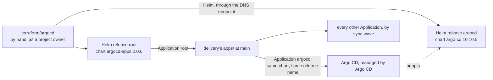

# Root argocd: Argo CD's bootstrap

**Decision**: `terraform/argocd` installs Argo CD into the cluster once, with the `root` Application, and then stands aside: Argo CD manages itself and everything else in the cluster from `arikkfir-org/delivery`. The owner applies it by hand, when a cluster has no Argo CD; no pipeline plans or applies it.



| Resource | What |
| --- | --- |
| `helm_release.argocd` | Chart `argo-cd` 10.10.5 into namespace `argocd`, with only what bootstrap needs: every pod on node pool `system` (its node selector and a toleration of the pool's taint, the only pool with a node at that point), `server.insecure` (Traefik terminates TLS), Dex off. `ignore_changes = all` |
| `helm_release.root` | Chart `argocd-apps` 2.0.6: Application `root` in project `default`, syncing `apps/` of `https://github.com/arikkfir-org/delivery` at `main`, automated with prune and self-heal, retrying up to 10 times with a back-off from 10 seconds to 5 minutes, since child Applications gate the waves through their health |
| Providers | `google`, for an access token and the cluster's DNS endpoint (data sources only); `helm`, connecting to `https://<DNS endpoint>` with that token and no CA certificate |

State: prefix `argocd` in `arikkfir-devops`. Inputs default to the hub's: project `arikkfir`, cluster `hub` in `me-west1-a`.

## The handoff

After the first sync, Argo CD manages itself through Application `argocd` in `delivery`, with the same chart and release name, so it adopts what the bootstrap installed. Argo CD applies manifests directly and never updates the Helm release record, so with `ignore_changes = all` Terraform installs Argo CD only where the release is missing, and never upgrades it or reverts Argo CD's own upgrades. Bootstrap resources that the self-managed values no longer render aren't pruned: delete them once by hand. Dex stays off in both, so none of its resources is left behind.

What Argo CD then deploys, and in which wave: delivery's [README](https://github.com/arikkfir-org/delivery#readme). The hub's node pools and their taints: [root gcp](gcp.md#node-pools).

## Decisions

| Decision | Why | Rejected |
| --- | --- | --- |
| A root of its own, applied after `gcp` | A Kubernetes provider can't be configured from a cluster that the same apply creates | One root with `-target` applies |
| Bootstrap only, `ignore_changes = all`, never in a pipeline | Argo CD manages itself afterwards; applying again would fight it | Terraform managing Argo CD's upgrades |
| App of apps (`root`) with sync waves | Deterministic order (CRDs before their users) with plain Argo CD | ApplicationSets (indirection for a fixed set) |
| The access token alone, no `cluster_ca_certificate` | The DNS-based endpoint serves a publicly trusted certificate (Google Trust Services), not one the cluster's CA signs; setting the CA would replace the system trust store and fail verification | The cluster's CA certificate |
| `root` follows `delivery`'s `main` | Git is the source of truth; every merge to `delivery` deploys | Pinned revisions, bumped by hand |

## Running it

```bash
make terraform argocd    # terraform -chdir=terraform/argocd init, then apply
gcloud container clusters get-credentials hub --location=me-west1-a --dns-endpoint
kubectl -n argocd get applications -w    # everything converges to Synced and Healthy
```

It needs Google credentials with `container.clusters.connect` (a project owner has it): `gcloud auth application-default login`. The whole sequence: the [bootstrap runbook](../runbooks/bootstrap.md).
