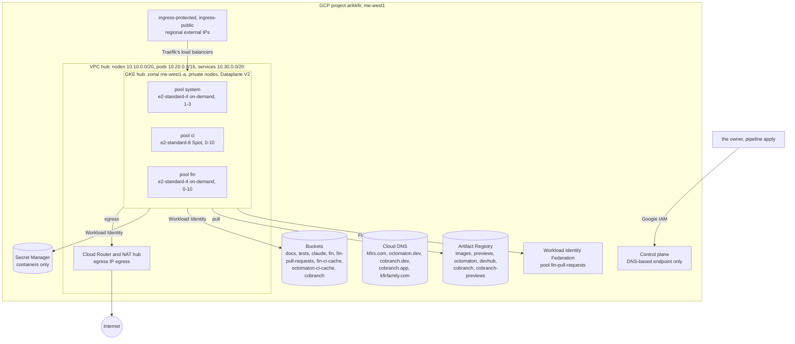
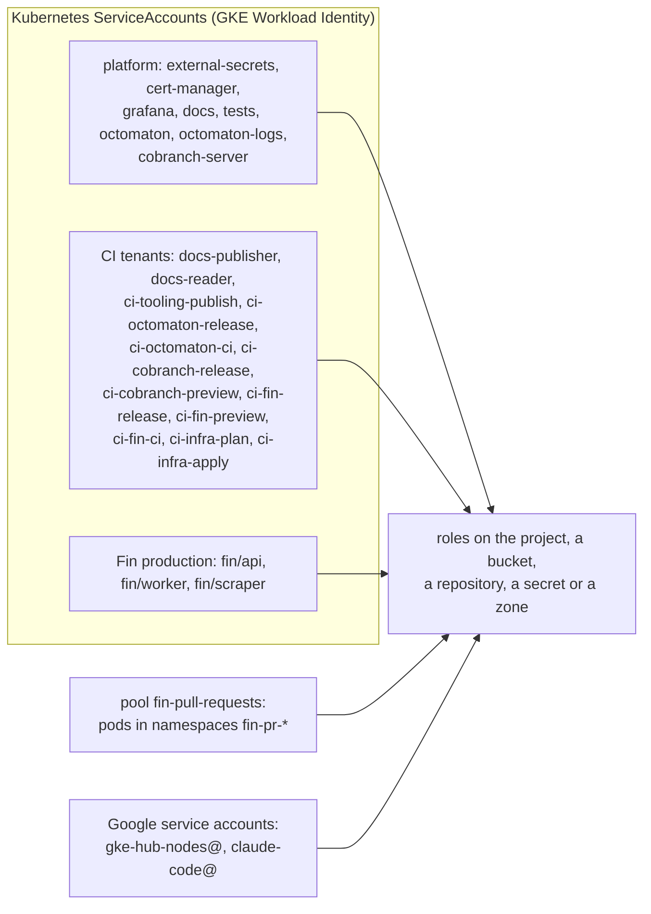

# Root gcp: the GCP project

**Decision**: `terraform/gcp` builds everything the hub runs on in GCP project `arikkfir` (`me-west1`): the APIs, a private network with Cloud NAT on one egress IP and two ingress IPs, one zonal GKE cluster with three tainted node pools, six Docker repositories, the buckets, the Secret Manager containers, every IAM grant and the DNS zones and records. Workloads authenticate as their Kubernetes ServiceAccounts through Workload Identity, never with keys. Pipeline `apply` applies it on every merge to `main` ([Terraform plan and apply](../designs/terraform-plan-apply.md)). This page documents every name, range and grant it creates; other repositories link it rather than repeat them.

## Topology

| Area | File | Resources |
| --- | --- | --- |
| APIs | `apis.tf` | the services below, never disabled on destroy |
| Network | `network.tf` | VPC `hub`, subnet `hub` with ranges `pods` and `services`, Cloud Router and NAT `hub`, addresses `egress`, `ingress-protected` and `ingress-public` |
| GKE | `gke.tf` | cluster `hub`, node pools `system`, `ci` and `fin`, node service account `gke-hub-nodes@` |
| Artifact Registry | `registry.tf` | Docker repositories `images`, `previews`, `octomaton`, `devhub`, `cobranch` and `cobranch-previews` |
| Storage | `storage.tf` | eight buckets |
| Secret Manager | `secrets.tf` | twenty-four secret containers |
| IAM | `iam.tf` | grants to Kubernetes principals and two Google service accounts, pool `fin-pull-requests` and its provider, service account `claude-code@` |
| DNS | `dns.tf` | zones `kfirs-com`, `kfirfamily-com`, `octomaton-dev`, `cobranch-dev` and `cobranch-app`, the hub's hosts, `octomaton.dev`, `cobranch.dev`, `cobranch.app` and `git.cobranch.app` |
| Adopted | `imports.tf` | zones `kfirs-com` and `kfirfamily-com`, service account `claude-code@` and its viewer role, all made by hand first |

Project `arikkfir` is number `8909046976`, in GCP organization `468825984716`. State: prefix `gcp` in bucket `arikkfir-devops`, which the owner made by hand and which no root manages ([buckets](#buckets)).

## APIs

`aiplatform`, `artifactregistry`, `cloudresourcemanager`, `cloudtrace`, `compute`, `container`, `dns`, `iam`, `iamcredentials`, `logging`, `monitoring`, `secretmanager`, `serviceusage`, `storage`, `sts` and `telemetry` (each `.googleapis.com`). `sts` and `iamcredentials` serve the token exchange of pool `fin-pull-requests`; `telemetry` takes Octomaton's and Fin's metrics and traces over OTLP; `aiplatform` serves Fin's models.

## Network

| Resource | What |
| --- | --- |
| VPC `hub` | Custom subnets, regional routing |
| Subnet `hub` | Nodes on `10.10.0.0/20`, with Private Google Access; secondary ranges `pods` (`10.20.0.0/16`) and `services` (`10.30.0.0/20`) for GKE's VPC-native networking |
| Cloud Router and NAT `hub` | Egress for the private nodes and their pods, from address `egress` only, logging errors only |
| `egress` | Regional external IP (Premium tier), the NAT's only one: every node and pod reaches the internet from it, so an outside allow-list, such as Namecheap's API's, names the hub by it. One IP gives the NAT 64,512 ports, 64 per node, so it serves up to 1,008 nodes |
| `ingress-protected`, `ingress-public` | Regional external IPs (Premium tier) that Traefik's two load balancers bind by name; the DNS records below point at them |

**No firewall rules.** The cluster uses Private Service Connect: it has no `master_ipv4_cidr_block`, and GKE creates the `gke-hub-…-master` rule, which limits the control plane to TCP 443 and 10250, only for clusters that use VPC peering ([automatically created firewall rules](https://cloud.google.com/kubernetes-engine/docs/concepts/firewall-rules)). The API server reaches nodes and pods through Konnectivity: `konnectivity-agent` pods open connections to the control plane on TCP 8132, which default egress allows. Webhook calls, aggregated APIs such as KEDA's metrics server on 6443, and `logs`/`exec` traffic arrive from those pods' IPs, which GKE's own `gke-hub-…-all` rule allows on every port ([Konnectivity requirements](https://cloud.google.com/kubernetes-engine/docs/troubleshooting/kubectl)), so webhooks on 9443, 8443 or 10250 need no rule. NetworkPolicy still applies, since Dataplane V2 enforces it: a namespace with default-deny ingress must admit `kube-system` (konnectivity-agent) to its webhook and APIService ports. To confirm on a new cluster: `gcloud compute firewall-rules list --filter="name~^gke-hub-"` lists no `-master` rule, and `kubectl -n kube-system get deploy konnectivity-agent` finds the agent. If a `-master` rule appears, the cluster uses VPC peering: add an ingress rule from that rule's source range for the webhook ports.

## GKE

| Setting | Value | Why |
| --- | --- | --- |
| Cluster | `hub`, zonal in `me-west1-a`, release channel `RAPID`, minimum version 1.36, deletion protection | The free tier pays one zonal cluster's management fee. Its single control plane is unavailable while GKE upgrades it |
| Networking | VPC-native on the ranges above; Dataplane V2 (eBPF), which also enforces NetworkPolicy | No Calico add-on, which GKE doesn't combine with Dataplane V2 |
| Workload Identity | Pool `arikkfir.svc.id.goog`; every node pool in `GKE_METADATA` mode | IAM grants go straight to `namespace/ServiceAccount` principals (IAM below) |
| Nodes | Private (no external IPs); shielded, with secure boot and integrity monitoring; Container-Optimized OS, 50 GB `pd-balanced` boot disks | Egress only through Cloud NAT |
| Control plane | The DNS-based endpoint only (`*.gke.goog`, IAM-authenticated, reachable from anywhere); both IP-based endpoints off | Access needs Google credentials, never an address on a list: `gcloud container clusters get-credentials hub --location=me-west1-a --dns-endpoint`. The endpoint serves a publicly trusted certificate (Google Trust Services), so clients pass only an access token ([root argocd](argocd.md)) |
| Gateway API | GKE's controller off (`CHANNEL_DISABLED`) | Argo CD installs the Gateway API's CRDs and Traefik, which implements them |
| Add-ons | Cloud Storage FUSE CSI driver on; HTTP load balancing (GKE Ingress) and the Filestore CSI driver off | FUSE mounts `arikkfir-docs` and `arikkfir-tests` into the docs and tests sites. Nothing mounts a shared volume, and a claim on a `*-rwx` storage class would create a Filestore instance of a terabyte at least |
| Autoscaling profile | `OPTIMIZE_UTILIZATION` | Pods go to the fullest node that fits them, and empty nodes go sooner ([node autoscaling](../designs/node-autoscaling.md)) |
| Observability | System and workload logs to Cloud Logging; system metrics only, plus Managed Service for Prometheus for `PodMonitoring` resources | Free system metrics; workloads export their own through the Telemetry API |
| Maintenance | Fridays and Saturdays, 00:00 to 08:00 UTC | The Israeli weekend |

**Load balancers.** Traefik's two `LoadBalancer` Services use backend service-based external passthrough network load balancers (`loadBalancerClass: networking.gke.io/l4-regional-external`), which bind `ingress-protected` and `ingress-public` by name. With the HTTP load balancing add-on off, GKE serves such load balancers only from 1.36 on, hence the cluster's minimum version. No GKE Ingress or Gateway resources are used.

### Node pools

Each pool's taint keeps every workload but its own off it, and each pool's nodes carry its label, `kfirs.com/pool=<pool>`, which workloads select ([node pools](../designs/node-pools.md); the workloads' side in delivery's [node pools](../../delivery/designs/node-pools.md)).

| Pool | Machine | VMs | Nodes | Taint (`NoSchedule`) | Runs |
| --- | --- | --- | --- | --- | --- |
| `system` | `e2-standard-4` | on-demand | 1-3 | `components.gke.io/gke-managed-components=true`, GKE's own | GKE's managed components and the hub's services |
| `ci` | `e2-standard-8` | Spot | 0-10 | `kfirs.com/pool=ci` | Tekton's TaskRun pods |
| `fin` | `e2-standard-4` | on-demand | 0-10 | `kfirs.com/pool=fin` | Fin's environments |

All three run as `gke-hub-nodes@`, a Google service account with `roles/container.defaultNodeServiceAccount` and read access to the private Docker repositories, `images`, `previews` and `cobranch-previews` (`octomaton`, `devhub` and `cobranch` are public, so the nodes pull them as anyone does), auto-repair and auto-upgrade on. `system` ignores changes to its initial node count, which a manual resize changes and which would otherwise replace the pool. Changing `ci`'s `spot` replaces the pool, the node that runs pipeline `apply` included, so the owner applies that by hand. `ci`'s kubelet pulls up to 5 images at once, GKE's most (its default is 2 or 3, by boot disk), since a TaskRun pod pulls an image for each container that always pulls. Changing a kubelet setting re-creates the pool's nodes at once, that node included, so the owner applies that by hand too.

## Artifact Registry

| Repository | Holds | Written by | Cleanup |
| --- | --- | --- | --- |
| `me-west1-docker.pkg.dev/arikkfir/images` | What runs from `main`: the reviewer's `reviewer`, Fin's five images | `ci-tooling-publish` and `ci-fin-release`, from `main` only | Untagged versions after 14 days, except each image's 20 newest |
| `me-west1-docker.pkg.dev/arikkfir/previews` | Fin's pull requests' images | `ci-fin-preview`, from any branch | Every version after 14 days, except each image's 20 newest |
| `me-west1-docker.pkg.dev/arikkfir/octomaton` | Octomaton's releases, `octomaton` and `octomaton-logs`: every commit on `main`, tagged with its short SHA, and every version, tagged `vX.Y.Z` (the same images, retagged) ([releases](https://github.com/arikkfir-org/octomaton#releases)) | `ci-octomaton-release`, from `main` and `v*` tags only | Untagged versions after 14 days, except each image's 20 newest |
| `me-west1-docker.pkg.dev/arikkfir/devhub` | DevHub's releases, as published before its rename to Cobranch: images `devhub` and `devhub-console` and Helm chart `charts/devhub` at 0.0.1 | Nobody | Untagged versions after 14 days, except each image's 20 newest |
| `me-west1-docker.pkg.dev/arikkfir/cobranch` | Cobranch's releases: images `cobranch` and `cobranch-console` of `main`'s newest commit, tagged with its short SHA, and every version, tagged `X.Y.Z` (the same images, retagged); Helm chart `charts/cobranch` at every version ([the Cobranch repository](../../cobranch/designs/repository.md)) | `ci-cobranch-release`, from `main` and `v*` tags only | Untagged versions after 14 days, except each image's 20 newest |
| `me-west1-docker.pkg.dev/arikkfir/cobranch-previews` | Cobranch's pull requests' images, `cobranch` and `cobranch-console` of each pushed head commit, tagged with its short SHA | `ci-cobranch-preview`, from any branch | Every version after 14 days, except each image's 20 newest |

The nodes read `images`, `previews` and `cobranch-previews`; `octomaton`, `devhub` and `cobranch` are public, so every installation of Octomaton or Cobranch, the hub's included, pulls them as anyone, and DevHub's 0.0.1 stays pullable. Production never pulls from `previews`, so a pull request's code can't replace what production runs. Cobranch's pull requests push to `cobranch-previews`, not `previews`: the repository is public and its pull requests' CI runs Dependabot's dependency code, which must not be able to replace Fin's preview images, nor `cobranch`'s `main` and release tags. Only its previews pull from it.

Cobranch was DevHub until [ENG-221](https://linear.app/arikkfir/issue/ENG-221) renamed it. DevHub's names went with its demo and previews, except repository `devhub`, which keeps DevHub's 0.0.1 as published.

## Buckets

All in `ME-WEST1`, with uniform bucket-level access.

| Bucket | Public access | Objects deleted after | Holds | Read by | Written by |
| --- | --- | --- | --- | --- | --- |
| `arikkfir-docs` | prevented | never | Every repository's docs, a layer each under `.layers/<repository>/` | the docs site (`docs/docs`), `claude-code@`, each tenant's `docs-reader` (names only) | each tenant's `docs-publisher`, its own layer only, from `main` |
| `arikkfir-tests` | prevented | 30 days | What CI's tests keep: Fin's end-to-end reports under `reports/fin/<run>/` | the tests site (`tests/tests`) | `ci-fin-ci`, creating only, under `reports/fin/` |
| `arikkfir-claude` | open | never | The Claude Code web bundle and its installer, `setup.sh` | anyone, by URL, `https://storage.googleapis.com/arikkfir-claude/<path>` (no listing) | `ci-tooling-publish`, from `main` |
| `arikkfir-fin` | prevented | 30 days | Fin production's scrape videos, traces and raw statements | `fin/api`, `fin/worker` | `fin/scraper`, creating only |
| `arikkfir-fin-pull-requests` | prevented | 7 days | The same for every Fin pull request's environment, under its name | pool `fin-pull-requests` | pool `fin-pull-requests` |
| `arikkfir-fin-ci-cache` | prevented | 14 days | Fin's CI caches | `ci-fin-ci`, `ci-fin-preview` | `ci-fin-release`, from `main` |
| `arikkfir-octomaton-ci-cache` | prevented | 14 days | Octomaton's Go caches: `main`'s, and each pull request's under `pull-requests/<number>/` | `ci-octomaton-ci`, `ci-octomaton-release` | `ci-octomaton-release`, `main`'s; `ci-octomaton-ci`, from any branch, under `pull-requests/` only |
| `arikkfir-cobranch` | prevented | never | The objects of Cobranch's demo installation | `cobranch/cobranch-server` | `cobranch/cobranch-server` |
| `arikkfir-devops` | prevented | never (versioned) | Terraform's state, a prefix per root: `gcp`, `github`, `argocd`, `keycloak`, `namecheap` | `ci-infra-plan` | `ci-infra-apply`; made by hand, outside every root ([bootstrap runbook](../runbooks/bootstrap.md#1-terraform-state-bucket)) |

A bucket made with uniform access also gets Cloud Storage's convenience bindings, which let the project's Viewers read its objects; `claude-code@` is one ([Claude Code cluster and docs access](../../tooling/designs/claude-code-cluster-access.md)). The docs and tests sites: delivery's [docs and tests servers](../../delivery/designs/docs-and-tests-servers.md). Fin's buckets: Fin's [environments](../../fin/designs/environments.md).

## Secret Manager

`terraform/gcp` creates the containers only. The owner adds values with `gcloud secrets versions add <name> --data-file=-` ([bootstrap runbook](../runbooks/bootstrap.md#5-secret-values)), except the five Keycloak client secrets that [root keycloak](keycloak.md#generated-secrets) generates and writes. `cobranch-app-google-client-secret` is the one whose client the owner makes by hand too, outside Google Cloud's API ([cobranch.app](../designs/cobranch-app.md#manual-steps)). External Secrets Operator (`external-secrets/external-secrets`) syncs every secret but the seven pipeline secrets into the Kubernetes Secret named below, which the repository named with it declares.

| Secret | Content | Value set by | Read by |
| --- | --- | --- | --- |
| `octomaton-github-app-id` | Octomaton's GitHub App's ID ([bootstrap runbook](../runbooks/bootstrap.md#2-github-apps)) | the owner | octomaton's `octomaton/octomaton-github`, key `app-id` |
| `octomaton-github-private-key` | Its private key (PEM) | the owner | the same, key `private-key` |
| `octomaton-github-webhook-secret` | Its webhook secret | the owner | the same, key `webhook-secret` |
| `argocd-github-app-id` | Argo CD's GitHub App's ID ([bootstrap runbook](../runbooks/bootstrap.md#2-github-apps)) | the owner | delivery's `argocd/github-app` (Argo CD's credentials for `fin`), key `githubAppID` |
| `argocd-github-app-private-key` | Its private key (PEM) | the owner | the same, key `githubAppPrivateKey` |
| `oauth2-proxy-cookie-secret` | 32 random bytes, base64 | the owner | delivery's `auth/oauth2-proxy`, key `cookie-secret` |
| `keycloak-bootstrap-admin` | Secret of Keycloak's temporary bootstrap admin, service account `bootstrap-admin` in realm `master` | the owner | delivery's `keycloak/keycloak-bootstrap-admin`, key `client-secret` |
| `keycloak-google-client-secret` | Secret of the Google OAuth client of identity provider `google` ([root keycloak](keycloak.md#realm-hub)) | the owner | delivery's `keycloak/keycloak-vault`, keys `hub_google-client-secret` and `master_google-client-secret` (Keycloak's file vault) |
| `keycloak-hub-client-secret` | Secret of Keycloak client `hub` | root keycloak; the owner's placeholder before its first apply | delivery's `auth/oauth2-proxy`, key `client-secret`, and `argocd/argocd-oidc`, key `clientSecret` |
| `keycloak-cobranch-client-secret` | Secret of Keycloak client `cobranch` ([root keycloak](keycloak.md#clients)) | root keycloak | delivery's `cobranch/cobranch-keycloak`, key `client-secret`, for the demo's Auth server |
| `cobranch-app-google-client-secret` | Secret of the Google OAuth client that `cobranch.app` signs people in with ([cobranch.app](../designs/cobranch-app.md#manual-steps)) | the owner | delivery's `cobranch-app/cobranch-google`, key `client-secret`, for `cobranch.app`'s Auth server |
| `grafana-postgres-admin-password` | Password of superuser `postgres` on Grafana's PostgreSQL | the owner | delivery's `grafana/postgres-admin`, key `password` |
| `fin-postgres-arik-password` | Password of role `arik`, the superuser people sign in as, on Fin production's PostgreSQL | the owner | fin's `fin/db-arik`, key `password` |
| `fin-scraper-sealing-key` | 32 random bytes, base64: the seed of the key pair that seals Fin production's bank credentials and browser sessions | the owner | fin's `fin/scraper-sealing-key`, key `key` |
| `reviewer-deepseek-api-key` | DeepSeek API key | the owner | delivery's `ci-<repository>/reviewer-deepseek-api-key`, key `api-key`, for tooling's pull request reviewer |
| `reviewer-github-pat` | `arikkfir-reviewer`'s fine-grained token | the owner | delivery's `ci-<repository>/reviewer-github-pat`, key `token`, for the same |
| `linear-api-key` | The owner's Linear API key, with permission Read on team ENG only | the owner | delivery's `ci-<repository>/linear-api-key`, key `api-key`, for tooling's check `Linear` |
| `infra-plan-github-pat` | The plans' GitHub token ([GitHub tokens](../designs/terraform-plan-apply.md#github-tokens)) | the owner | `ci-infra-plan`, at run time |
| `infra-apply-github-pat` | The applies' GitHub token | the owner | `ci-infra-apply`, at run time, through `roles/secretmanager.admin` |
| `infra-plan-keycloak-secret` | Secret of Keycloak client `terraform-plan` | root keycloak | `ci-infra-plan`, at run time |
| `infra-apply-keycloak-secret` | Secret of Keycloak client `terraform-apply` | root keycloak | `ci-infra-apply`, at run time, through `roles/secretmanager.admin` |
| `infra-namecheap-api-user` | The Namecheap account's user name, which its API takes as both `ApiUser` and `UserName` | the owner | `ci-infra-plan`, at run time, and `ci-infra-apply`, through `roles/secretmanager.admin` |
| `infra-namecheap-api-key` | The Namecheap account's API key, which Namecheap accepts only from the IPs on the account's allow-list, here address `egress` ([network](#network)). It has no read-only kind, so it can change or transfer every domain of the account | the owner | the same |
| `ci-fin-e2e-keycloak-secret` | Secret of Keycloak client `fin-e2e` | root keycloak | `ci-fin/ci-fin-ci`, at run time ([test users](../designs/test-users.md)) |

The seven pipeline secrets never pass through External Secrets, so no Kubernetes Secret holds them: Octomaton lets no `push` pipeline mount one, and a pull request's pipeline can't name one at all.

## IAM

Kubernetes workloads authenticate with GKE's Workload Identity Federation, and their grants go straight to their principal, `principal://iam.googleapis.com/projects/8909046976/locations/global/workloadIdentityPools/arikkfir.svc.id.goog/subject/ns/<namespace>/sa/<name>`: no Google service account to impersonate, and no key. Each grant is at the narrowest scope that works: a bucket, a repository, a secret or a zone before the project.

Every grant `iam.tf` makes:

| Principal | Roles | Scope | For |
| --- | --- | --- | --- |
| `external-secrets/external-secrets` | `roles/secretmanager.secretAccessor` | Each secret but the seven pipeline secrets | Syncs them into Kubernetes Secrets ([Secret Manager](#secret-manager)) |
| `cert-manager/cert-manager` | `roles/dns.admin` | Zones `kfirs-com`, `octomaton-dev`, `cobranch-dev` and `cobranch-app` | Let's Encrypt's DNS-01 challenges. Zone-scoped, so its solvers must name their zone |
| `grafana/grafana` | `roles/monitoring.viewer` | Project | Reads Cloud Monitoring |
| `docs/docs` | `roles/storage.objectViewer` | Bucket `arikkfir-docs` | The docs site serves it |
| `tests/tests` | `roles/storage.objectViewer` | Bucket `arikkfir-tests` | The tests site serves it |
| `octomaton/octomaton`, `octomaton/octomaton-logs` | `roles/telemetry.metricsWriter`, `roles/telemetry.tracesWriter`, `roles/serviceusage.serviceUsageConsumer` | Project | Metrics and traces, through the Telemetry API |
| `octomaton/octomaton-logs` | `roles/logging.viewAccessor`, on view `_Default` of log bucket `_Default` only (IAM condition) | Project | The logs of CI pods that are gone ([archived step logs](../../octomaton/designs/archived-step-logs.md)) |
| `ci-<repository>/docs-publisher` | `roles/storage.objectUser`, on objects under `.layers/<repository>/` only (IAM condition); `roles/storage.legacyBucketReader` | Bucket `arikkfir-docs` | Publishes its repository's docs layer, from `main` |
| `ci-<repository>/docs-reader` | `roles/storage.legacyBucketReader` | Bucket `arikkfir-docs` | Lists the bucket's names, for the `Docs` check on pull requests |
| `ci-tooling/ci-tooling-publish` | `roles/storage.objectUser`, `roles/storage.legacyBucketReader` | Bucket `arikkfir-claude` | Publishes the Claude Code bundle, from `main` |
| `ci-tooling/ci-tooling-publish` | `roles/artifactregistry.writer` | Repository `images` | The reviewer's image, from `main` |
| `ci-octomaton/ci-octomaton-release` | `roles/artifactregistry.writer` | Repository `octomaton` | Octomaton's images, from `main` and from version tags (`v*`) |
| `ci-octomaton/ci-octomaton-release` | `roles/storage.objectUser` | Bucket `arikkfir-octomaton-ci-cache` | Restores and saves `main`'s Go caches, from `main` |
| `ci-octomaton/ci-octomaton-ci` | `roles/storage.objectViewer` | Bucket `arikkfir-octomaton-ci-cache` | Restores `main`'s or its pull request's Go caches, from any branch. They hold nothing secret |
| `ci-octomaton/ci-octomaton-ci` | `roles/storage.objectUser`, on objects under `pull-requests/` only (IAM condition) | Bucket `arikkfir-octomaton-ci-cache` | Saves each pull request's Go caches, from any branch; it can't change `main`'s |
| `ci-cobranch/ci-cobranch-release` | `roles/artifactregistry.writer` | Repository `cobranch` | Cobranch's images, from `main`; a version's image tags and chart, from `v*` tags |
| `ci-fin/ci-fin-release` | `roles/artifactregistry.writer` | Repository `images` | Fin's images, from `main` |
| `ci-fin/ci-fin-release` | `roles/storage.objectUser` | Bucket `arikkfir-fin-ci-cache` | Saves Fin's CI cache, from `main` |
| `ci-cobranch/ci-cobranch-preview` | `roles/artifactregistry.writer` | Repository `cobranch-previews` | Cobranch's pull requests' images, from any branch |
| `ci-fin/ci-fin-preview` | `roles/artifactregistry.writer` | Repository `previews` | Fin's pull requests' images, from any branch |
| `ci-fin/ci-fin-preview`, `ci-fin/ci-fin-ci` | `roles/storage.objectViewer` | Bucket `arikkfir-fin-ci-cache` | Restore Fin's CI cache, from any branch. It holds nothing secret |
| `ci-fin/ci-fin-ci` | `roles/storage.objectCreator`, on objects under `reports/fin/` only (IAM condition) | Bucket `arikkfir-tests` | Fin's end-to-end reports, from any branch; it can't change or delete them ([CI reports](../../fin/designs/ci-reports.md)) |
| `ci-fin/ci-fin-ci` | `roles/secretmanager.secretAccessor` | Secret `ci-fin-e2e-keycloak-secret` | Client `fin-e2e`, which creates and deletes Fin's test users only ([test users](../designs/test-users.md)) |
| `ci-infra/ci-infra-plan` | `roles/iam.securityReviewer`, `roles/serviceusage.serviceUsageViewer`, `roles/compute.networkViewer`, `roles/container.clusterViewer`, `roles/artifactregistry.reader`, `roles/secretmanager.viewer`, `roles/dns.reader`, `roles/iam.serviceAccountViewer`, `roles/iam.workloadIdentityPoolViewer`, `roles/monitoring.viewer` | Project | Plans: reads everything this root manages, every IAM policy and alert policy included ([identities](../designs/terraform-plan-apply.md#identities)) |
| `ci-infra/ci-infra-plan` | `roles/storage.legacyBucketReader` | Each bucket this root manages | Reads their settings |
| `ci-infra/ci-infra-plan` | `roles/storage.objectViewer` | Bucket `arikkfir-devops` | Reads Terraform's state, without the lock |
| `ci-infra/ci-infra-plan` | `roles/secretmanager.secretAccessor` | Secrets `infra-plan-github-pat`, `infra-plan-keycloak-secret`, `infra-namecheap-api-user` and `infra-namecheap-api-key` | Its GitHub token and Keycloak credential, and the Namecheap API user and key that applies use too, at run time |
| `ci-infra/ci-infra-apply` | `roles/serviceusage.serviceUsageAdmin`, `roles/compute.networkAdmin`, `roles/container.admin`, `roles/artifactregistry.admin`, `roles/storage.admin`, `roles/secretmanager.admin`, `roles/dns.admin`, `roles/iam.serviceAccountAdmin`, `roles/iam.securityAdmin`, `roles/iam.workloadIdentityPoolAdmin`, `roles/monitoring.alertPolicyEditor`, `roles/monitoring.notificationChannelEditor` | Project | Applies, from `main`: an admin role per resource type, Cloud Monitoring's alert policies and notification channels included, and the project's and DNS zones' IAM policies ([identities](../designs/terraform-plan-apply.md#identities)) |
| `ci-infra/ci-infra-apply` | `roles/iam.serviceAccountUser` | Service account `gke-hub-nodes@` | Creates node pools that run as it |
| `fin/api`, `fin/worker`, `fin/scraper` | `roles/telemetry.tracesWriter`, `roles/telemetry.metricsWriter`, `roles/serviceusage.serviceUsageConsumer` | Project | Traces and metrics |
| `fin/worker` | `roles/aiplatform.user` | Project | Calls Gemini on Vertex AI |
| `fin/api`, `fin/worker` | `roles/storage.objectViewer` | Bucket `arikkfir-fin` | Read the scraper's artifacts |
| `fin/scraper` | `roles/storage.objectCreator` | Bucket `arikkfir-fin` | Writes its scrape videos, traces and raw statements, and can't read them back |
| Pool `fin-pull-requests`, every identity in it | `roles/telemetry.tracesWriter`, `roles/telemetry.metricsWriter`, `roles/serviceusage.serviceUsageConsumer`, `roles/aiplatform.user` | Project | The same as production's, for every pull request's environment ([below](#pool-fin-pull-requests)) |
| Pool `fin-pull-requests`, every identity in it | `roles/storage.objectUser` | Bucket `arikkfir-fin-pull-requests` | The environments' scrape artifacts, under each one's name |
| `cobranch/cobranch-server` | `roles/storage.objectUser` | Bucket `arikkfir-cobranch` | Cobranch's demo installation: its servers and maintenance job keep their objects there |
| `gke-hub-nodes@` | `roles/container.defaultNodeServiceAccount` | Project | Runs the nodes |
| `gke-hub-nodes@` | `roles/artifactregistry.reader` | Repositories `images`, `previews` and `cobranch-previews` | Pulls images (`octomaton`, `devhub` and `cobranch` need no grant: `allUsers` reads them) |
| `claude-code@` | `roles/viewer`, `roles/mcp.toolUser` | Project | Claude Code's cloud sessions look around the project and read the cluster through GKE's MCP server ([Claude Code cluster and docs access](../../tooling/designs/claude-code-cluster-access.md)) |
| `claude-code@` | `roles/storage.objectViewer` | Bucket `arikkfir-docs` | The sessions read the docs site's pages from its layers |
| `allUsers` | `roles/storage.legacyObjectReader` | Bucket `arikkfir-claude` | Anyone reads its objects by URL, without listing them |
| `allUsers` | `roles/artifactregistry.reader` | Repository `octomaton` | Anyone pulls Octomaton's releases, the hub's nodes included |
| `allUsers` | `roles/artifactregistry.reader` | Repository `devhub` | Anyone pulls DevHub's 0.0.1 |
| `allUsers` | `roles/artifactregistry.reader` | Repository `cobranch` | Anyone pulls Cobranch's images and chart, the hub's nodes included |

`<repository>` is each repository with a CI tenant: `chrome-extensions`, `cobranch`, `delivery`, `docs`, `fin`, `infra`, `octomaton` and `tooling` (`local.docs_layers`). `gke-hub-nodes@` and `claude-code@` are the project's two Google service accounts (`<name>@arikkfir.iam.gserviceaccount.com`); `claude-code@` was made by hand, with its key, and is adopted here. "From `main`" means the ServiceAccount is annotated `octomaton.dev/branches: main`, and "from version tags" that it is annotated `octomaton.dev/tags: v*` too, so a run of a `v*` tag may use it as well. A CI tenant's own ServiceAccount, `pipeline`, holds no role: a pipeline that needs Google Cloud names one of its own, which `delivery` creates and, when it publishes, restricts to `main` (and, for Octomaton's and Cobranch's releases, to `v*` tags) ([Octomaton's tenancy and identity](../../octomaton/designs/phase-2-octomaton.md#tenancy-and-identity)).

### Pool fin-pull-requests

Fin's pull requests' environments come and go with their namespaces, `fin-pr-<number>`, and GKE's own pool grants only to namespaces named in advance. Pool `fin-pull-requests` has one OIDC provider, `gke-hub`, which trusts the hub cluster's ServiceAccount tokens from namespaces whose names start with `fin-pr-` only. A pod presents a projected token of the provider's audience through an `external_account` credential file, and its grants go to every identity in the pool. How Fin uses it: Fin's [environments](../../fin/designs/environments.md).

| Piece | Value |
| --- | --- |
| Issuer | `https://container.googleapis.com/v1/projects/arikkfir/locations/me-west1-a/clusters/hub`, the cluster's, whose keys GKE publishes. No allowed audiences: tokens name the provider itself |
| Attribute mapping | `google.subject` from `assertion.sub`; `attribute.namespace` from `assertion['kubernetes.io']['namespace']` |
| Attribute condition | `assertion['kubernetes.io']['namespace'].startsWith('fin-pr-')` |
| Member of its grants | `principalSet://iam.googleapis.com/projects/8909046976/locations/global/workloadIdentityPools/fin-pull-requests/*` |

This root manages no other pool: not GKE's own, `arikkfir.svc.id.goog`, nor `github-actions` and `greenstar`, which predate it.

## DNS

| Zone | Domain | Records |
| --- | --- | --- |
| `kfirs-com` | `kfirs.com` | An A record per hub host, pointing at the IP of the gateway that serves it (below) |
| `octomaton-dev` | `octomaton.dev` | The apex, on the public gateway: Octomaton's webhook and Go import page. Delegated to this zone at Namecheap by [root namecheap](namecheap.md) |
| `cobranch-dev` | `cobranch.dev` | The apex, on the public gateway: Cobranch's site and Go import page (`cobranch.dev` is its module path). Cobranch's open-source product, which anyone installs. Delegated to this zone at Namecheap by [root namecheap](namecheap.md) |
| `cobranch-app` | `cobranch.app` | The apex and `git.cobranch.app`, on the public gateway: Cobranch's hosted service, its Console and APIs at the apex and its Git server at `git` ([cobranch.app](../designs/cobranch-app.md)). Delegated to this zone at Namecheap by [root namecheap](namecheap.md) |
| `kfirfamily-com` | `kfirfamily.com` | Unused; imported with `kfirs-com` |

| Gateway | Hosts (under `kfirs.com`) |
| --- | --- |
| `protected` (behind the hub's sign-in) | `argocd.dev`, `tekton.dev`, `grafana.dev`, `traefik.dev`, `nui.dev`, `docs.dev`, `tests.dev`, `cobranch.dev`, `*.cobranch.dev`, `admin.id`, `app.fin`, `*.app.dev.fin` |
| `public` | `auth`, `id`, `legal`, `fin`, `git.cobranch.dev`, `*.git.cobranch.dev` |

All records live 300 seconds. The zones are `prevent_destroy`, and the imported ones' attributes mirror the live zones, so importing them planned no change. Fin's pull requests' wildcard sits at `*.app.dev.fin`, beside its certificate's DNS-01 challenge records: a record at `_acme-challenge.app.dev.fin` would stop a wildcard higher up from answering for the names below `app.dev.fin`. Cobranch's previews answer at `pr-<number>.cobranch.dev`, beside the demo's `cobranch.dev`; their challenge record, `_acme-challenge.cobranch.dev`, is a sibling of those names and leaves the wildcard alone. These are hosts under `kfirs.com`, behind the hub's sign-in, whose cookie covers `kfirs.com` only; the domain `cobranch.dev` is the product's. Their Git servers answer on the public gateway, since a Git client can't pass the hub's sign-in and the Git server authenticates every request itself: the demo's at `git.cobranch.dev`, each preview's at `pr-<number>.git.cobranch.dev`. A preview's Git server runs its pull request's own code, Dependabot's dependency bumps included, so these hosts put that code on the internet; the owner accepted that for every preview on 2026-11-01, and `delivery` scopes their routes and admission to the Git server alone. Once `git.cobranch.dev` exists, `*.cobranch.dev` no longer answers for the names below it, so they have the wildcard `*.git.cobranch.dev`; its certificate's challenge record, `_acme-challenge.git.cobranch.dev`, is a sibling of those names too.

## Outputs

`cluster_name`, `cluster_location`, `cluster_dns_endpoint`, `egress_ip`, which the owner adds to the allow-list of a service that admits callers by IP, such as Namecheap's API ([root namecheap](namecheap.md#namecheaps-api)), `ingress_protected_ip`, `ingress_public_ip`, `artifact_registry_url`, `octomaton_registry_url`, `devhub_registry_url`, `cobranch_registry_url`, `bucket_names`, and `octomaton_dev_name_servers`, `cobranch_dev_name_servers` and `cobranch_app_name_servers`, the zones' name servers, which [root namecheap](namecheap.md) reads from the zones and sets at Namecheap.

## Decisions

| Decision | Why | Rejected |
| --- | --- | --- |
| One zonal cluster, `me-west1-a` | The free tier covers one zonal cluster's management fee; a personal hub doesn't need a regional control plane | A regional cluster, about $73 a month more (switch `zone` to the region) |
| Private nodes and only the DNS-based control plane endpoint | No public node IPs; the control plane needs Google credentials, from anywhere | Authorized networks (address lists); a bastion |
| Workload Identity principals, no Google service accounts for workloads | Fewer identities and no keys: IAM binds straight to `namespace/ServiceAccount` | A Google service account per workload, impersonated |
| A Workload Identity Federation pool for Fin's pull requests only | Their namespaces don't exist when Terraform runs; the provider's condition keeps every other namespace, CI's included, out | A grant to the whole cluster; no Google access in pull requests; keys |
| No pool for GitHub | No GitHub Actions run: CI runs in the cluster, as Kubernetes ServiceAccounts | A GitHub OIDC pool without grants |
| Three tainted node pools | The hub's services, CI's bursts and Fin's end-to-end suites stop starving each other ([node pools](../designs/node-pools.md)) | One pool for everything |
| Spot VMs for `ci` | CI is bursty and retryable, and Spot costs a fraction. From 1 to 12 October `ci` ran on-demand, after Spot capacity in the region ran out often enough to preempt most runs | On-demand CI nodes (the cost); CI on the system pool |
| GKE's Gateway controller off, the CRDs from Argo CD | Traefik implements the Gateway API | GKE's controller |
| One reserved egress IP | Namecheap's API admits only the IPs on its allow-list, and Google's auto-allocated NAT IPs change without notice | Auto-allocated NAT IPs; a proxy with an IP of its own |
| L4 passthrough load balancers bound to reserved IPs | The IPs outlive the Services, so DNS never changes | Ephemeral IPs; GKE Ingress |
| Grants at the narrowest scope: bucket, repository, secret, zone, with IAM conditions on prefixes | A compromised workload reaches only its own objects | Project-wide roles |
| Imports adopt what existed (the zones, `claude-code@`) | Nothing is recreated, so no record or key is lost | Recreating them |
| Octomaton's and Cobranch's images in public repositories of their own | Each is a product other installations run, and its images are its releases; `images` holds Fin's production images and the reviewer's, which stay private | Public read on `images`; a reader grant per installation |
| Monitoring collects system metrics only, plus Managed Prometheus | Workload metrics come through the Telemetry API, and the free tier covers system metrics | GKE's paid workload metrics |

## Security

- Workloads hold no Google key: their tokens, and the nodes', come from the metadata server. The one key is `claude-code@`'s, made by hand, which the Claude Code environment holds.
- Secret values live only in Secret Manager and in the Kubernetes Secrets External Secrets makes; Terraform never holds one, and its state holds no value.
- A CI tenant's `pipeline` has no role, and every ServiceAccount that publishes what production runs or serves is restricted to `main` by Octomaton (`ci-octomaton-release` to `main` and `v*` tags; a `v*` tag takes only write access to push, so Octomaton's `tag` pipeline, read at `main`, refuses a tagged commit that is not on `main`). Four write from any branch, by design: `ci-fin-preview` to `previews`, which only pull requests' environments pull, `ci-cobranch-preview` to `cobranch-previews`, which only Cobranch's previews pull, `ci-fin-ci` to `arikkfir-tests`, under `reports/fin/`, behind the hub's sign-in, and `ci-octomaton-ci` to `arikkfir-octomaton-ci-cache`, under `pull-requests/`, which only pull requests' runs restore.
- `ci-infra-apply` holds `roles/iam.securityAdmin` and could grant itself more; only merges to `main` run as it ([Terraform plan and apply](../designs/terraform-plan-apply.md)).
- `claude-code@`, a project Viewer, reads every bucket's objects through Cloud Storage's convenience bindings, `arikkfir-fin`'s raw statements included.

## Cost

The cluster's management fee is the free tier's. The `ci` and `fin` pools scale to zero, though `fin` always holds production's node, and `system` keeps at least one. `ci` runs Spot VMs, which a preemption can take from a run mid-task. Monitoring is free system metrics only.
