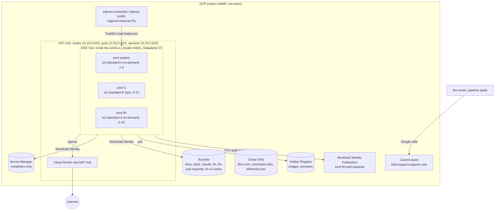
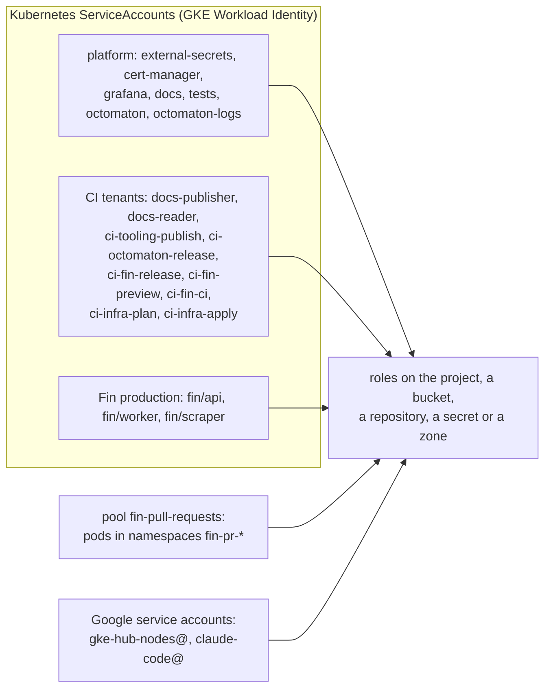

# Root gcp: the GCP project

**Decision**: `terraform/gcp` builds everything the hub runs on in GCP project `arikkfir` (`me-west1`): the APIs, a private network with Cloud NAT and two ingress IPs, one zonal GKE cluster with three tainted node pools, two Docker repositories, the buckets, the Secret Manager containers, every IAM grant and the DNS zones and records. Workloads authenticate as their Kubernetes ServiceAccounts through Workload Identity, never with keys. Pipeline `apply` applies it on every merge to `main` ([Terraform plan and apply](../designs/terraform-plan-apply.md)). Every name, range and grant is in the hub reference, which this root implements: [network](../../hub/reference.md#network), [GKE](../../hub/reference.md#gke), [Artifact Registry and buckets](../../hub/reference.md#artifact-registry-and-buckets), [Secret Manager](../../hub/reference.md#secret-manager), [GCP identities and permissions](../../hub/reference.md#gcp-identities-and-permissions).

## Topology

| Area | File | Resources |
| --- | --- | --- |
| APIs | `apis.tf` | the services below, never disabled on destroy |
| Network | `network.tf` | VPC `hub`, subnet `hub` with ranges `pods` and `services`, Cloud Router and NAT `hub`, addresses `ingress-protected` and `ingress-public` |
| GKE | `gke.tf` | cluster `hub`, node pools `system`, `ci` and `fin`, node service account `gke-hub-nodes@` |
| Artifact Registry | `registry.tf` | Docker repositories `images` and `previews` |
| Storage | `storage.tf` | six buckets |
| Secret Manager | `secrets.tf` | nineteen secret containers |
| IAM | `iam.tf` | grants to Kubernetes principals and two Google service accounts, pool `fin-pull-requests` and its provider, service account `claude-code@` |
| DNS | `dns.tf` | zones `kfirs-com`, `kfirfamily-com` and `octomaton-dev`, the hub's hosts and `octomaton.dev` |
| Adopted | `imports.tf` | zones `kfirs-com` and `kfirfamily-com`, service account `claude-code@` and its viewer role, all made by hand first |

State: prefix `gcp` in bucket `arikkfir-devops`, which the owner made by hand and which no root manages.

## APIs

`aiplatform`, `artifactregistry`, `cloudresourcemanager`, `cloudtrace`, `compute`, `container`, `dns`, `iam`, `iamcredentials`, `logging`, `monitoring`, `secretmanager`, `serviceusage`, `storage`, `sts` and `telemetry` (each `.googleapis.com`). `sts` and `iamcredentials` serve the token exchange of pool `fin-pull-requests`; `telemetry` takes Octomaton's and Fin's metrics and traces over OTLP; `aiplatform` serves Fin's models.

## Network

| Resource | What |
| --- | --- |
| VPC `hub` | Custom subnets, regional routing |
| Subnet `hub` | Nodes on `10.10.0.0/20`, with Private Google Access; secondary ranges `pods` (`10.20.0.0/16`) and `services` (`10.30.0.0/20`) for GKE's VPC-native networking |
| Cloud Router and NAT `hub` | Egress for the private nodes and their pods, on auto-allocated IPs, logging errors only |
| `ingress-protected`, `ingress-public` | Regional external IPs (Premium tier) that Traefik's two load balancers bind by name; the DNS records below point at them |

**No firewall rules.** The cluster uses Private Service Connect: it has no `master_ipv4_cidr_block`, and GKE creates the `gke-hub-…-master` rule, which limits the control plane to TCP 443 and 10250, only for clusters that use VPC peering ([automatically created firewall rules](https://cloud.google.com/kubernetes-engine/docs/concepts/firewall-rules)). The API server reaches nodes and pods through Konnectivity: `konnectivity-agent` pods open connections to the control plane on TCP 8132, which default egress allows. Webhook calls, aggregated APIs such as KEDA's metrics server on 6443, and `logs`/`exec` traffic arrive from those pods' IPs, which GKE's own `gke-hub-…-all` rule allows on every port ([Konnectivity requirements](https://cloud.google.com/kubernetes-engine/docs/troubleshooting/kubectl)), so webhooks on 9443, 8443 or 10250 need no rule. NetworkPolicy still applies, since Dataplane V2 enforces it: a namespace with default-deny ingress must admit `kube-system` (konnectivity-agent) to its webhook and APIService ports. To confirm on a new cluster: `gcloud compute firewall-rules list --filter="name~^gke-hub-"` lists no `-master` rule, and `kubectl -n kube-system get deploy konnectivity-agent` finds the agent. If a `-master` rule appears, the cluster uses VPC peering: add an ingress rule from that rule's source range for the webhook ports.

## GKE

| Setting | Value | Why |
| --- | --- | --- |
| Cluster | `hub`, zonal in `me-west1-a`, release channel `REGULAR`, minimum version 1.36, deletion protection | The free tier pays one zonal cluster's management fee. Its single control plane is unavailable while GKE upgrades it |
| Networking | VPC-native on the ranges above; Dataplane V2 (eBPF), which also enforces NetworkPolicy | No Calico add-on, which GKE doesn't combine with Dataplane V2 |
| Workload Identity | Pool `arikkfir.svc.id.goog`; every node pool in `GKE_METADATA` mode | IAM grants go straight to `namespace/ServiceAccount` principals (IAM below) |
| Nodes | Private (no external IPs); shielded, with secure boot and integrity monitoring; Container-Optimized OS, 50 GB `pd-balanced` boot disks | Egress only through Cloud NAT |
| Control plane | The DNS-based endpoint only (`*.gke.goog`, IAM-authenticated, reachable from anywhere); both IP-based endpoints off | Access needs Google credentials, never an address on a list: `gcloud container clusters get-credentials hub --location=me-west1-a --dns-endpoint`. The endpoint serves a publicly trusted certificate (Google Trust Services), so clients pass only an access token ([root argocd](argocd.md)) |
| Gateway API | GKE's controller off (`CHANNEL_DISABLED`) | Argo CD installs the Gateway API's CRDs and Traefik, which implements them |
| Add-ons | Cloud Storage FUSE CSI driver on; HTTP load balancing (GKE Ingress) and the Filestore CSI driver off | FUSE mounts `arikkfir-docs` and `arikkfir-tests` into the docs and tests sites. Nothing mounts a shared volume, and a claim on a `*-rwx` storage class would create a Filestore instance of a terabyte at least |
| Autoscaling profile | `OPTIMIZE_UTILIZATION` | Pods go to the fullest node that fits them, and empty nodes go sooner ([node autoscaling](../designs/node-autoscaling.md)) |
| Observability | System and workload logs to Cloud Logging; system metrics only, plus Managed Service for Prometheus for `PodMonitoring` resources | Free system metrics; workloads export their own through the Telemetry API |
| Maintenance | Fridays and Saturdays, 00:00 to 08:00 UTC | The Israeli weekend |

**Load balancers.** Traefik's two `LoadBalancer` Services use backend service-based external passthrough network load balancers (`loadBalancerClass: networking.gke.io/l4-regional-external`), which bind `ingress-protected` and `ingress-public` by name. With the HTTP load balancing add-on off, GKE serves such load balancers only from 1.36 on, hence the cluster's minimum version. No GKE Ingress or Gateway resources are used.

### Node pools

Each pool's taint keeps every workload but its own off it, and each pool's nodes carry its label, `kfirs.com/pool=<pool>`, which workloads select ([node pools](../designs/node-pools.md); the workloads' side in delivery's [node pools](../../delivery/designs/node-pools.md)).

| Pool | Machine | VMs | Nodes | Taint (`NoSchedule`) | Runs |
| --- | --- | --- | --- | --- | --- |
| `system` | `e2-standard-4` | on-demand | 1-3 | `components.gke.io/gke-managed-components=true`, GKE's own | GKE's managed components and the hub's services |
| `ci` | `e2-standard-8` | Spot | 0-10 | `kfirs.com/pool=ci` | Tekton's TaskRun pods |
| `fin` | `e2-standard-4` | on-demand | 0-10 | `kfirs.com/pool=fin` | Fin's environments |

All three run as `gke-hub-nodes@`, a Google service account with `roles/container.defaultNodeServiceAccount` and read access to both Docker repositories, auto-repair and auto-upgrade on. `system` ignores changes to its initial node count, which a manual resize changes and which would otherwise replace the pool. Changing `ci`'s `spot` replaces the pool, the node that runs pipeline `apply` included, so the owner applies that by hand. `ci`'s kubelet pulls up to 5 images at once, GKE's most (its default is 2 or 3, by boot disk), since a TaskRun pod pulls an image for each container that always pulls. Changing a kubelet setting re-creates the pool's nodes at once, that node included, so the owner applies that by hand too.

## Artifact Registry

| Repository | Holds | Written by | Cleanup |
| --- | --- | --- | --- |
| `me-west1-docker.pkg.dev/arikkfir/images` | What runs from `main`: Octomaton's `octomaton` and `octomaton-logs`, the reviewer's `reviewer`, Fin's five images | `ci-octomaton-release` and `ci-fin-release`, from `main` only | Untagged versions after 14 days, except each image's 20 newest |
| `me-west1-docker.pkg.dev/arikkfir/previews` | Fin's pull requests' images | `ci-fin-preview`, from any branch | Every version after 14 days, except each image's 20 newest |

The nodes read both. Production never pulls from `previews`, so a pull request's code can't replace what production runs.

## Buckets

All in `ME-WEST1`, with uniform bucket-level access.

| Bucket | Public access | Objects deleted after | Holds | Read by | Written by |
| --- | --- | --- | --- | --- | --- |
| `arikkfir-docs` | prevented | never | Every repository's docs, a layer each under `.layers/<repository>/` | the docs site (`docs/docs`), `claude-code@`, each tenant's `docs-reader` (names only) | each tenant's `docs-publisher`, its own layer only, from `main` |
| `arikkfir-tests` | prevented | 30 days | What CI's tests keep: Fin's end-to-end reports under `reports/fin/<run>/` | the tests site (`tests/tests`) | `ci-fin-ci`, creating only, under `reports/fin/` |
| `arikkfir-claude` | open | never | The Claude Code web bundle and its installer, `setup.sh` | anyone, by URL (no listing) | `ci-tooling-publish`, from `main` |
| `arikkfir-fin` | prevented | 30 days | Fin production's scrape videos, traces and raw statements | `fin/api`, `fin/worker` | `fin/scraper`, creating only |
| `arikkfir-fin-pull-requests` | prevented | 7 days | The same for every Fin pull request's environment, under its name | pool `fin-pull-requests` | pool `fin-pull-requests` |
| `arikkfir-fin-ci-cache` | prevented | 14 days | Fin's CI caches | `ci-fin-ci`, `ci-fin-preview` | `ci-fin-release`, from `main` |
| `arikkfir-devops` | prevented | never (versioned) | Terraform's state, a prefix per root | `ci-infra-plan` | `ci-infra-apply`; made by hand, outside every root |

A bucket made with uniform access also gets Cloud Storage's convenience bindings, which let the project's Viewers read its objects; `claude-code@` is one ([Claude Code cluster and docs access](../../hub/designs/claude-code-cluster-access.md)). The docs and tests sites: delivery's [docs and tests servers](../../delivery/designs/docs-and-tests-servers.md). Fin's buckets: Fin's [environments](../../fin/designs/environments.md).

## Secret Manager

`terraform/gcp` creates the containers only. The owner adds values with `gcloud secrets versions add <name> --data-file=-`, except the four Keycloak client secrets that [root keycloak](keycloak.md) generates and writes. Each secret's content and consumer: the reference's [Secret Manager](../../hub/reference.md#secret-manager).

| Secrets | Read by |
| --- | --- |
| `octomaton-github-app-id`, `octomaton-github-private-key`, `octomaton-github-webhook-secret`; `oauth2-proxy-cookie-secret`; `keycloak-bootstrap-admin`, `keycloak-google-client-secret`, `keycloak-hub-client-secret`; `grafana-postgres-admin-password`; `argocd-github-app-id`, `argocd-github-app-private-key`; `fin-postgres-arik-password`, `fin-scraper-sealing-key`; `reviewer-deepseek-api-key`, `reviewer-github-pat` | External Secrets Operator (`external-secrets/external-secrets`), which syncs them into the namespaces that use them |
| `infra-plan-github-pat`, `infra-plan-keycloak-secret` | `ci-infra-plan`, at run time |
| `infra-apply-github-pat`, `infra-apply-keycloak-secret` | `ci-infra-apply`, at run time, through `roles/secretmanager.admin` |
| `ci-fin-e2e-keycloak-secret` | `ci-fin-ci`, at run time ([test users](../designs/test-users.md)) |

The five pipeline secrets never pass through External Secrets, so no Kubernetes Secret holds them: Octomaton lets no `push` pipeline mount one, and a pull request's pipeline can't name one at all.

## IAM

Kubernetes workloads authenticate with GKE's Workload Identity Federation, and their grants go straight to their principal, `principal://iam.googleapis.com/projects/8909046976/locations/global/workloadIdentityPools/arikkfir.svc.id.goog/subject/ns/<namespace>/sa/<name>`: no Google service account to impersonate, and no key. Each grant is at the narrowest scope that works: a bucket, a repository, a secret or a zone before the project.

| Who | What for |
| --- | --- |
| `external-secrets/external-secrets` | Reads every secret but the five pipeline secrets |
| `cert-manager/cert-manager` | Administers zones `kfirs-com` and `octomaton-dev`, for Let's Encrypt's DNS-01 challenges. Zone-scoped, so its solvers must name their zone |
| `grafana/grafana` | Reads Cloud Monitoring |
| `docs/docs`, `tests/tests` | Read their bucket |
| `octomaton/octomaton`, `octomaton/octomaton-logs` | Write metrics and traces; `octomaton-logs` also reads the `_Default` log view, for the logs of CI pods that are gone |
| Each tenant's `docs-publisher` and `docs-reader` | `docs-publisher` writes its own layer of `arikkfir-docs` (an IAM condition on `.layers/<repository>/`); both list the bucket's names |
| `ci-tooling-publish`, `ci-octomaton-release`, `ci-fin-release` | Publish from `main`: the Claude Code bundle, Octomaton's and the reviewer's images, Fin's images and CI cache |
| `ci-fin-preview`, `ci-fin-ci` | From any branch: Fin's pull requests' images, its end-to-end reports, client `fin-e2e`'s secret, and reading the CI cache |
| `fin/api`, `fin/worker`, `fin/scraper` | Write traces and metrics; the API and the worker read `arikkfir-fin`, which the scraper writes; the worker calls Vertex AI |
| Pool `fin-pull-requests` | The same for every pull request's environment, on `arikkfir-fin-pull-requests` |
| `ci-infra-plan`, `ci-infra-apply` | Plan and apply the roots ([Terraform plan and apply](../designs/terraform-plan-apply.md#identities)) |
| `gke-hub-nodes@` | Runs the nodes; pulls images |
| `claude-code@` | Claude Code's cloud sessions: the project's Viewer, Google's MCP servers' tools, and the docs bucket ([Claude Code cluster and docs access](../../hub/designs/claude-code-cluster-access.md)). Made by hand, with its key, and adopted here |

A CI tenant's own ServiceAccount, `pipeline`, holds no role: a pipeline that needs Google Cloud names one of its own, which `delivery` creates and, when it publishes, restricts to `main` ([Octomaton's tenancy and identity](../../octomaton/designs/phase-2-octomaton.md#tenancy-and-identity)). Every role and scope: the reference's [GCP identities and permissions](../../hub/reference.md#gcp-identities-and-permissions).

### Pool fin-pull-requests

Fin's pull requests' environments come and go with their namespaces, `fin-pr-<number>`, and GKE's own pool grants only to namespaces named in advance. Pool `fin-pull-requests` has one OIDC provider, `gke-hub`, which trusts the hub cluster's ServiceAccount tokens (its issuer, `https://container.googleapis.com/v1/projects/arikkfir/locations/me-west1-a/clusters/hub`, whose keys GKE publishes) from namespaces whose names start with `fin-pr-` only. A pod presents a projected token of the provider's audience through an `external_account` credential file, and its grants go to every identity in the pool. How Fin uses it: Fin's [environments](../../fin/designs/environments.md).

## DNS

| Zone | Domain | Records |
| --- | --- | --- |
| `kfirs-com` | `kfirs.com` | An A record per hub host, pointing at the IP of the gateway that serves it (below) |
| `octomaton-dev` | `octomaton.dev` | The apex, on the public gateway: Octomaton's webhook and Go import page. Delegated to this zone at the domain's registrar |
| `kfirfamily-com` | `kfirfamily.com` | Unused; imported with `kfirs-com` |

| Gateway | Hosts (under `kfirs.com`) |
| --- | --- |
| `protected` (behind the hub's sign-in) | `argocd.dev`, `tekton.dev`, `grafana.dev`, `traefik.dev`, `nui.dev`, `docs.dev`, `tests.dev`, `admin.id`, `app.fin`, `*.app.dev.fin` |
| `public` | `auth`, `id`, `legal`, `fin` |

All records live 300 seconds. The zones are `prevent_destroy`, and their attributes mirror the live zones, so importing them planned no change. Fin's pull requests' wildcard sits at `*.app.dev.fin`, beside its certificate's DNS-01 challenge records: a record at `_acme-challenge.app.dev.fin` would stop a wildcard higher up from answering for the names below `app.dev.fin`.

## Outputs

`cluster_name`, `cluster_location`, `cluster_dns_endpoint`, `ingress_protected_ip`, `ingress_public_ip`, `artifact_registry_url`, `bucket_names`, and `octomaton_dev_name_servers`, which the owner sets at `octomaton.dev`'s registrar ([bootstrap runbook](../runbooks/bootstrap.md)).

## Decisions

| Decision | Why | Rejected |
| --- | --- | --- |
| One zonal cluster, `me-west1-a` | The free tier covers one zonal cluster's management fee; a personal hub doesn't need a regional control plane | A regional cluster, about $73 a month more (switch `zone` to the region) |
| Private nodes and only the DNS-based control plane endpoint | No public node IPs; the control plane needs Google credentials, from anywhere | Authorized networks (address lists); a bastion |
| Workload Identity principals, no Google service accounts for workloads | Fewer identities and no keys: IAM binds straight to `namespace/ServiceAccount` | A Google service account per workload, impersonated |
| A Workload Identity Federation pool for Fin's pull requests only | Their namespaces don't exist when Terraform runs; the provider's condition keeps every other namespace, CI's included, out | A grant to the whole cluster; no Google access in pull requests; keys |
| No pool for GitHub | No GitHub Actions run: CI runs in the cluster, as Kubernetes ServiceAccounts | A GitHub OIDC pool without grants |
| Three tainted node pools | The hub's services, CI's bursts and Fin's end-to-end suites stop starving each other ([node pools](../designs/node-pools.md)) | One pool for everything |
| Spot VMs for `ci` | CI is bursty and retryable, and Spot costs a fraction. From 1 to 12 October `ci` ran on-demand, after Spot capacity in the region ran out often enough to preempt most runs | On-demand CI nodes (the cost); CI on the system pool |
| GKE's Gateway controller off, the CRDs from Argo CD | Traefik implements the Gateway API | GKE's controller |
| L4 passthrough load balancers bound to reserved IPs | The IPs outlive the Services, so DNS never changes | Ephemeral IPs; GKE Ingress |
| Grants at the narrowest scope: bucket, repository, secret, zone, with IAM conditions on prefixes | A compromised workload reaches only its own objects | Project-wide roles |
| Imports adopt what existed (the zones, `claude-code@`) | Nothing is recreated, so no record or key is lost | Recreating them |
| Monitoring collects system metrics only, plus Managed Prometheus | Workload metrics come through the Telemetry API, and the free tier covers system metrics | GKE's paid workload metrics |

## Security

- Workloads hold no Google key: their tokens, and the nodes', come from the metadata server. The one key is `claude-code@`'s, made by hand, which the Claude Code environment holds.
- Secret values live only in Secret Manager and in the Kubernetes Secrets External Secrets makes; Terraform never holds one, and its state holds no value.
- A CI tenant's `pipeline` has no role, and every ServiceAccount that publishes what production runs or serves is restricted to `main` by Octomaton. Two write from any branch, by design: `ci-fin-preview` to `previews`, which only pull requests' environments pull, and `ci-fin-ci` to `arikkfir-tests`, under `reports/fin/`, behind the hub's sign-in.
- `ci-infra-apply` holds `roles/iam.securityAdmin` and could grant itself more; only merges to `main` run as it ([Terraform plan and apply](../designs/terraform-plan-apply.md)).
- `claude-code@`, a project Viewer, reads every bucket's objects through Cloud Storage's convenience bindings, `arikkfir-fin`'s raw statements included.

## Cost

The cluster's management fee is the free tier's. The `ci` and `fin` pools scale to zero, though `fin` always holds production's node, and `system` keeps at least one. `ci` runs Spot VMs, which a preemption can take from a run mid-task. Monitoring is free system metrics only.
