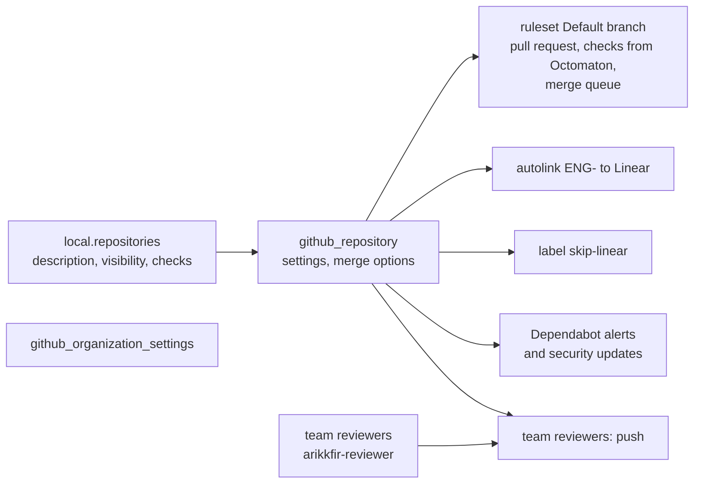

# Root github: the GitHub organization

**Decision**: `terraform/github` manages the `arikkfir-org` organization's settings and every repository in it: their settings, their `Default branch` ruleset, their `ENG-` autolink to Linear, their label `skip-linear`, Dependabot's alerts and security updates, and team `reviewers`, through which the pull request reviewer may approve. Every repository gets the same settings and the same ruleset; only its description, its visibility and its extra required checks differ. Pipeline `apply` applies it on every merge to `main` ([Terraform plan and apply](../designs/terraform-plan-apply.md)). This page documents every repository, setting and rule it creates; other repositories link it rather than repeat them.

| File | Resources |
| --- | --- |
| `organization.tf` | `github_organization_settings.arikkfir_org` |
| `repositories.tf` | `local.repositories`; per repository: `github_repository`, `github_repository_vulnerability_alerts`, `github_repository_dependabot_security_updates`, `github_repository_autolink_reference` |
| `rulesets.tf` | `github_repository_ruleset` `Default branch` per repository |
| `labels.tf` | `github_issue_label` `skip-linear` per repository |
| `teams.tf` | team `reviewers` (closed), its member `arikkfir-reviewer`, and `push` on every repository |
| `imports.tf` | the seven repositories and the organization, which existed before |

State: prefix `github` in `arikkfir-devops`. The provider authenticates with `GITHUB_TOKEN`: the pipelines' fine-grained tokens ([GitHub tokens](../designs/terraform-plan-apply.md#github-tokens)), or, by hand, a token with the permissions the README lists.

## Repositories

| Repository | Visibility | Purpose | Default-branch rules | Required checks |
| --- | --- | --- | --- | --- |
| `.github` | public | The organization's welcome page on GitHub, `profile/README.md`, and nothing else | Pull request, one approval, merge queue | `Continuous Integration`, `Docs`, `Linear`, which nothing reports: without a CI tenant, its pull requests merge with the bypass |
| `docs` | public | The hub-wide knowledge base; with every repository's `docs/`, the docs site | Pull request, one approval, merge queue | `Continuous Integration`, `Docs`, `Linear` |
| `infra` | public | Terraform for GCP, GitHub, the Argo CD bootstrap and Keycloak's configuration; plans and applies `gcp`, `github` and `keycloak` | Pull request, one approval, a merge queue of one | `Continuous Integration` (tests, `fmt`, `validate`, plans), `Docs`, `Linear` |
| `delivery` | public | Argo CD's applications (GitOps) for the hub cluster | Pull request, one approval, merge queue | `Continuous Integration`, `Docs`, `Linear` |
| `octomaton` | public | The CI orchestrator: a GitHub App that runs Tekton pipelines | Pull request, one approval, merge queue | `Continuous Integration`, `Docs`, `Linear` |
| `tooling` | public | The Claude Code bundle, the pull request reviewer and the organization pipelines every repository runs | Pull request, one approval, merge queue | `Continuous Integration`, `Docs`, `Linear` |
| `fin` | internal: members of the organization's enterprise only | Fin, a personal finance manager and assistant | Pull request, one approval, merge queue | `Continuous Integration`, `Docs`, `Linear` |

No repository adds checks of its own today (`checks` in `local.repositories`). Every repository gets the same settings:

| Setting | Value |
| --- | --- |
| Features | Discussions on; issues, wiki and projects off |
| Merging | Merge commits, squash and rebase allowed, the ruleset narrowing pull requests to merge commits; the pull request's title and description as the merge commit's message; auto-merge, branch updates and head-branch deletion on |
| Forking | Public repositories only |
| Autolink | `ENG-<num>`, alphanumeric, to `https://linear.app/arikkfir/issue/ENG-<num>` |
| Label | `skip-linear` (grey, `8a93a3`): a pull request with no Linear issue carries it, and check `Linear` passes it ([Linear](../../CONTRIBUTING.md#linear)) |
| Dependabot | Alerts and security updates on; version updates need a `.github/dependabot.yml` in the repository |
| Deletion | `archive_on_destroy` and `prevent_destroy` keep Terraform from deleting one |

Adding a repository: an entry in `local.repositories`, and, if it already exists, in `imports.tf` (`CLAUDE.md`, "How to").

## The `Default branch` ruleset

| Rule | Value |
| --- | --- |
| Target | The default branch |
| Branch protection | No deletion, no force-push |
| Pull request | One approval, stale approvals dismissed, the last push approved by someone else, conversations resolved, merge commits only |
| Required checks | `Continuous Integration`, `Docs` and `Linear` (a Linear issue linked, or label `skip-linear`; [Linear](../../CONTRIBUTING.md#linear)), from Octomaton's App `octomaton-dev` only (`integration_id` 5114814, `local.octomaton_app_id`; [octomaton.dev](../../octomaton/designs/octomaton-dev.md)), plus a repository's own `checks`, from any source |
| Merge queue | Merge commits, every entry passing (`ALLGREEN`), up to 5 entries building and 1 to 5 pull requests a group, a 3-minute wait for the minimum, 60-minute check timeout. `infra`'s builds one entry at a time, in groups of exactly one (`local.serial_merge_queues`), so each merge is planned after the previous one was applied |
| Bypass | Organization admins and repository admins, always |
| Off | Restricted creations and updates, linear history, required deployments, signed commits, code owner and team reviews, up-to-date branches, skipping checks on creation |

`arikkfir-reviewer`'s approval counts toward the one required: team `reviewers` gives it `push` on every repository, which resolving review threads needs too ([pull request reviewer](../../tooling/designs/pr-reviewer.md)).

## The organization

| Setting | Value |
| --- | --- |
| Name | `arikkfir-org` |
| Description | A personal development hub: the home of personal projects, and of the platform they are built and run on. |
| Billing email | The owner's |
| Projects | Off, for the organization and its repositories |
| Base permission | Read |
| Repository creation by members | Off (public, private and internal), since repositories come from here; organization owners can still create them by hand |
| Pages sites by members | Off |
| Forking private and internal repositories | Off, which GitHub applies to internal repositories too, so `fin` can't be forked |
| Web commit sign-off | Not required |

`prevent_destroy` keeps a destroy from resetting the billing email.

## Set outside Terraform

The provider has no argument for these:

| Where | Setting |
| --- | --- |
| Each repository's Settings, General | Features: Sponsorships on, Preserve this repository off. GitHub's defaults, which need nothing unless someone changes them: pull requests open to all users, comments on individual commits allowed |
| The ruleset | "Restrict who can dismiss pull request reviews" (off by default), "Require an additional approval for unattributed Copilot pull requests" (on by default) |
| The organization | The rest of the profile (links, company, location, public email), ignored by Terraform; the security defaults for new repositories, which GitHub replaced with code security configurations. Dependabot is turned on per repository here instead |

## Decisions

| Decision | Why | Rejected |
| --- | --- | --- |
| One settings block and one ruleset for every repository | A new repository gets the hub's rules by being listed | Settings per repository, by hand |
| `Continuous Integration`, `Docs` and `Linear` pinned to the Octomaton App's ID | A check of that name from another App or a commit status counts for nothing | Checks by name alone |
| Bypass for admins, always | One person owns the hub, and can't approve their own pull requests | No bypass, which would block every merge without a second person |
| Merge queues, merge commits only | `git log --first-parent` reads as the list of merges, each with its pull request's description ([pull request titles](../../hub/designs/pull-request-titles.md)) | Squash merges; no queue |
| `infra`'s queue one entry at a time | Each merge's plan is the plan that is applied | Groups of up to five |
| Imported repositories and organization, `prevent_destroy` | Adopted with their history, never recreated | Recreating them |
| Repository creation off for members | Every repository comes through review, with its ruleset from the start | Creation by hand |
| A team for the reviewer, not a direct collaborator | One grant per repository, listed with the repositories | Inviting the user to each repository |
| Label `skip-linear` here, on every repository | Every repository has the same waiver from its creation, which Dependabot's configuration can name | Making it by hand in each repository |

## Running it

The ruleset requires checks from the Octomaton App, so a repository's first apply comes once Octomaton reports all three checks there; before that, its pull requests merge only through the bypass. By hand: `GITHUB_TOKEN=… make terraform github`. Its order in a bootstrap: the [bootstrap runbook](../runbooks/bootstrap.md).
