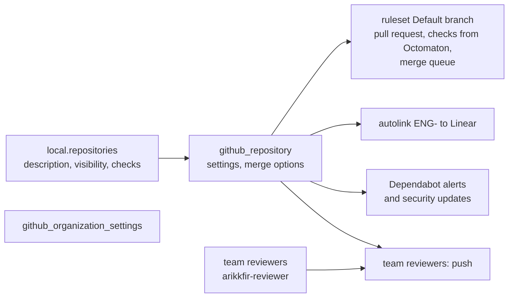

# Root github: the GitHub organization

**Decision**: `terraform/github` manages the `arikkfir-org` organization's settings and every repository in it: their settings, their `Default branch` ruleset, their `ENG-` autolink to Linear, Dependabot's alerts and security updates, and team `reviewers`, through which the pull request reviewer may approve. Every repository gets the same settings and the same ruleset; only its description, its visibility and its extra required checks differ. Pipeline `apply` applies it on every merge to `main` ([Terraform plan and apply](../designs/terraform-plan-apply.md)). The values: the reference's [Repositories](../../hub/reference.md#repositories) and [Organization](../../hub/reference.md#organization).

| File | Resources |
| --- | --- |
| `organization.tf` | `github_organization_settings.arikkfir_org` |
| `repositories.tf` | `local.repositories`; per repository: `github_repository`, `github_repository_vulnerability_alerts`, `github_repository_dependabot_security_updates`, `github_repository_autolink_reference` |
| `rulesets.tf` | `github_repository_ruleset` `Default branch` per repository |
| `teams.tf` | team `reviewers`, its member `arikkfir-reviewer`, and `push` on every repository |
| `imports.tf` | the seven repositories and the organization, which existed before |

State: prefix `github` in `arikkfir-devops`. The provider authenticates with `GITHUB_TOKEN`: the pipelines' fine-grained tokens ([GitHub tokens](../designs/terraform-plan-apply.md#github-tokens)), or, by hand, a token with the permissions the README lists.

## Repositories

| Repository | Visibility | What |
| --- | --- | --- |
| `.github` | public | The organization's welcome page; no CI |
| `docs` | public | The hub-wide knowledge base |
| `infra` | public | This repository |
| `delivery` | public | Argo CD's applications |
| `octomaton` | public | The CI orchestrator |
| `tooling` | public | The Claude Code bundle, the pull request reviewer, the organization pipelines |
| `fin` | internal | Fin; visible to the organization's enterprise only |

Each has discussions on and issues, wiki and projects off; merge commits, squash and rebase allowed, the ruleset narrowing pull requests to merge commits; the pull request's title and description as the merge commit's message; auto-merge, branch updates and head-branch deletion on; forking only if public. `archive_on_destroy` and `prevent_destroy` keep Terraform from deleting one. Adding a repository: an entry in `local.repositories`, and, if it already exists, in `imports.tf` (`CLAUDE.md`, "How to").

## The `Default branch` ruleset

| Rule | Value |
| --- | --- |
| Target | The default branch |
| Branch protection | No deletion, no force-push |
| Pull request | One approval, stale approvals dismissed, the last push approved by someone else, conversations resolved, merge commits only |
| Required checks | `Continuous Integration` and `Docs`, from the Octomaton App only (`integration_id` 5114814, `local.octomaton_app_id`), plus a repository's own `checks`, from any source |
| Merge queue | Merge commits, every entry passing (`ALLGREEN`), up to 5 entries building and 1 to 5 pull requests a group, a 3-minute wait for the minimum, 60-minute check timeout. `infra`'s builds one entry at a time, in groups of exactly one (`local.serial_merge_queues`), so each merge is planned after the previous one was applied |
| Bypass | Organization admins and repository admins, always |

`arikkfir-reviewer`'s approval counts toward the one required: team `reviewers` gives it `push` on every repository, which resolving review threads needs too ([pull request reviewer](../../hub/reference.md#pull-request-reviewer)).

## The organization

Its name, description and billing email; projects off; base permission read; repository creation and Pages sites by members off, since repositories come from here; forking private and internal repositories off; web commit sign-off not required. `prevent_destroy` keeps a destroy from resetting the billing email.

## Set outside Terraform

The provider has no argument for these:

| Where | Setting |
| --- | --- |
| Each repository's Settings, General | Features: Sponsorships on, Preserve this repository off. GitHub's defaults, which need nothing unless someone changes them: pull requests open to all users, comments on individual commits allowed |
| The ruleset | "Restrict who can dismiss pull request reviews" (off by default), "Require an additional approval for unattributed Copilot pull requests" (on by default) |
| The organization | The rest of the profile (links, company, location, public email), ignored by Terraform; the security defaults for new repositories, which GitHub replaced with code security configurations. Dependabot is turned on per repository here instead |

## Decisions

| Decision | Why | Rejected |
| --- | --- | --- |
| One settings block and one ruleset for every repository | A new repository gets the hub's rules by being listed | Settings per repository, by hand |
| `Continuous Integration` and `Docs` pinned to the Octomaton App's ID | A check of that name from another App or a commit status counts for nothing | Checks by name alone |
| Bypass for admins, always | One person owns the hub, and can't approve their own pull requests | No bypass, which would block every merge without a second person |
| Merge queues, merge commits only | `git log --first-parent` reads as the list of merges, each with its pull request's description ([pull request titles](../../hub/designs/pull-request-titles.md)) | Squash merges; no queue |
| `infra`'s queue one entry at a time | Each merge's plan is the plan that is applied | Groups of up to five |
| Imported repositories and organization, `prevent_destroy` | Adopted with their history, never recreated | Recreating them |
| Repository creation off for members | Every repository comes through review, with its ruleset from the start | Creation by hand |
| A team for the reviewer, not a direct collaborator | One grant per repository, listed with the repositories | Inviting the user to each repository |

## Running it

The ruleset requires checks from the Octomaton App, so a repository's first apply comes once Octomaton reports both checks there; before that, its pull requests merge only through the bypass. By hand: `GITHUB_TOKEN=… make terraform github`. Its order in a bootstrap: the [bootstrap runbook](../runbooks/bootstrap.md).
