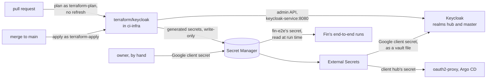

# Root keycloak: Keycloak's configuration

**Decision**: `terraform/keycloak` holds all of Keycloak's configuration: realm `hub`, which signs people in with Google, and only the people it declares; its clients for oauth2-proxy and Argo CD, Fin's local development and Fin's end-to-end runs; groups `admins` and `fin-e2e`; and, in realm `master`, the same Google sign-in for the administrators and the pipelines' own clients. It generates every client secret itself and writes it, write-only, to Keycloak and to Secret Manager, so no secret is in its state, its plans or Git. Pipeline `apply` applies it on every merge to `main`, after `gcp`, as client `terraform-apply`; pull requests plan it, without refreshing, as `terraform-plan` ([Terraform plan and apply](../designs/terraform-plan-apply.md)). Keycloak itself, its database and its routes run in the cluster, from `delivery`. The values: the reference's [Authentication](../../hub/reference.md#authentication).



| File | Resources |
| --- | --- |
| `realm.tf` | realm `hub`; realm `master`'s browser flow `browser-google`; flow `existing-users-only` and identity provider `google` in both realms; realm `hub`'s client policy `no-password-grants` |
| `clients.tf` | clients `hub`, `fin-local` and `fin-e2e` and their mappers; `fin-e2e`'s admin permission on group `fin-e2e`; the generated secrets and their Secret Manager versions |
| `users.tf` | the people (`local.users`), the administrators' users in realm `master`, groups `admins` and `fin-e2e` |
| `pipelines.tf` | clients `terraform-plan` and `terraform-apply` in realm `master`, their roles and secrets |

State: prefix `keycloak` in `arikkfir-devops`. Providers: `keycloak/keycloak` 5.9, `hashicorp/google` 8.5 (secret versions only) and `hashicorp/random` 3.9. The pipelines reach Keycloak's admin API through its in-cluster Service, `http://keycloak-service.keycloak.svc.cluster.local:8080` (the default of `keycloak_url`), which the server's NetworkPolicy admits from `ci-infra`; from a workstation, a port-forward and `-var keycloak_url=http://localhost:8080`.

## Realm hub

| Setting | Value | Why |
| --- | --- | --- |
| Registration, password reset, duplicate emails | Off | People exist only because this root declares them; test users only while a run of Fin's end-to-end suite needs them |
| Login with email | On | |
| Tokens and sessions | Access tokens 10 minutes; SSO sessions end after 7 idle days and 30 days at most | Longer than oauth2-proxy's 5-minute refresh, so the ID token it hands Argo CD never expires first; long sessions sign people in once a week at most |
| Browser flow | Keycloak's own `browser`, set on the realm: an existing session, or the login page with the username and password form and a button for Google | Only test users have passwords ([test users](../designs/test-users.md)). Set on `keycloak_realm`, whose updates write it from state, never through a binding (`CLAUDE.md`) |
| First broker login | `existing-users-only`: `idp-detect-existing-broker-user`, then `idp-auto-link` | A Google identity links to the declared user with the same email; anyone else is refused ([Keycloak's "existing users only" flow](https://www.keycloak.org/docs/latest/server_admin/index.html#_detect_existing_user_first_login_flow)) |
| Identity provider `google` | Google OIDC, client ID of the hub's Google OAuth client, client secret `${vault.google-client-secret}`, emails trusted, sync mode `IMPORT`, scopes `openid email profile` | The secret stays out of Terraform: Keycloak reads it from its file vault, which External Secrets fills from Secret Manager `keycloak-google-client-secret` |
| Client policy `no-password-grants` | Executor `reject-ropc-grant` for every client | Passwords go only through the login page, which Traefik limits per address: the token endpoint refuses password grants, `admin-cli` included |
| Brute-force detection | 1000 failures lock a user for a minute, and each failure after that again; no quick-login lockout | Locking someone out, Google sign-in included, takes many addresses, since Traefik limits each one's attempts |
| Admin permissions | On (fine-grained, v2), with their client `admin-permissions` | Client `fin-e2e`'s rights over group `fin-e2e` |

### Clients

| Client | Kind | What | Secret |
| --- | --- | --- | --- |
| `hub` | Confidential, standard flow only; redirect URIs `https://auth.kfirs.com/oauth2/callback` and `https://argocd.dev.kfirs.com/auth/callback` | Shared by oauth2-proxy and Argo CD, so Argo CD accepts the ID tokens oauth2-proxy forwards. Mapper `groups` puts the user's groups, by name, in its tokens and userinfo: the hub's tools admit only `admins`, and fin-api tells test users by `fin-e2e` | `keycloak-hub-client-secret` |
| `fin-local` | Public, standard flow with PKCE (`S256`) only; redirect URI `http://localhost:5173/oauth2/callback` | Fin's local development: its dev server signs a developer in, and the local fin-api accepts its ID tokens. Mapper `groups` too | none: its codes reach only the developer's machine |
| `fin-e2e` | Confidential, service account only | Fin's end-to-end runs create, sign in and delete members of group `fin-e2e`, and nobody else: admin permission `fin-e2e-members` (scopes `view`, `view-members`, `manage-members`, `manage-membership` on the group) for user policy `fin-e2e`, which names the client's service account user ([test users](../designs/test-users.md)) | `ci-fin-e2e-keycloak-secret`, which `ci-fin-ci` reads at run time |

### People and groups

`local.users` lists everyone who may sign in, keyed by the email of their Google account, which is also their username, with their first and last name. A user marked `admin = true` joins group `admins`, which alone the hub's tools admit, and also gets a user in realm `master` with realm role `admin`, which administers every realm. Group `fin-e2e` holds Fin's test users, which runs create and delete and Terraform never manages. Adding a person: `CLAUDE.md`, "How to".

## Realm master

Keycloak creates realm `master`; this root only configures it, through data sources.

| Piece | What |
| --- | --- |
| Browser flow `browser-google` | An existing session, or straight to Google (`identity-provider-redirector` with default provider `google`), bound to the realm. Only administrators sign in here, to the admin console |
| Identity provider `google`, flow `existing-users-only` | As in realm `hub`, for the administrators' users. Keycloak reads the secret from vault file `master_google-client-secret` |
| Clients `terraform-plan` and `terraform-apply` | Confidential service accounts for infra's pipelines. `terraform-plan`: roles `view-realm` and `view-clients` of client `master-realm` and `view-clients` of client `hub-realm`, which this root's data sources read. `terraform-apply`: realm role `admin`. Secrets `infra-plan-keycloak-secret` and `infra-apply-keycloak-secret` |
| The bootstrap admin | Service account `bootstrap-admin`, which the Keycloak operator creates on a fresh install from Secret Manager `keycloak-bootstrap-admin`. The first apply runs as it, by hand, and creates the pipelines' clients; then it is deleted ([bootstrap runbook](../runbooks/bootstrap.md)) |

## Generated secrets

Each client secret is an ephemeral `random_password` (48 letters and digits), written write-only to the client (`client_secret_wo`) and to a new version of its Secret Manager secret (`secret_data_wo`), both keyed to its entry in `local.secret_versions`. Bumping an entry rotates that secret: the next apply writes a new value to both. The secrets' containers come from [root gcp](gcp.md#secret-manager), which applies first. Refreshing a write-only version never reads its value, so plans need no access to any secret.

## Pull request plans don't refresh

Keycloak shows a client's secret only to administrators who can manage clients, and the provider reads the secret to refresh a client. So `ci` plans `keycloak` with `-refresh=false`, and `terraform-plan` reads only the data sources. Those plans compare the code with the state, and miss changes made in Keycloak itself; `apply` refreshes as `terraform-apply`, so such a change shows in the `Apply` check and is reverted.

## Decisions

| Decision | Why | Rejected |
| --- | --- | --- |
| All of Keycloak's configuration in Terraform, from its first apply | Who may sign in, and how, is reviewed code | Configuration in the console |
| People declared here, linked to Google by email; registration off | Keycloak documents this exact first-login flow, and nobody else gets in | Users managed in the console |
| Realm `hub`'s login page shows the password form beside Google | Fin's test users sign in with passwords ([test users](../designs/test-users.md)); people still click Google | Straight to Google, as realm `hub` did until 8 October and realm `master` still does |
| Administrators sign in to the console with Google, as users of realm `master` with realm role `admin` | The hub's sign-in, no password anywhere, and `admin` administers every realm, `hub` included. The console signs in against Keycloak's frontend hostname (ENG-66) | A password admin; admins of realm `hub` only, who can't administer `master` |
| Client secrets generated here and written write-only | No secret in state, plans or Git, and plans need no secret | Keycloak-generated secrets read into state; plans reading Secret Manager |
| The Google client secret through Keycloak's file vault | It is the one secret Terraform can't generate, so it takes the hub's usual path: `terraform/gcp` creates the container, the owner adds the value, External Secrets syncs it into Secret `keycloak-vault`, and Keycloak reads the mounted file. Keycloak's vault serves identity providers' secrets, never a client's own | Reading it in Terraform, which plans would then need |
| One confidential client, `hub`, for oauth2-proxy and Argo CD | Argo CD verifies the ID tokens oauth2-proxy forwards, so both share the audience | A client each (Argo CD would need `allowedAudiences`) |
| Two pipeline clients in realm `master`, read-only and admin | The same split as the GCP identities: pull requests can't change Keycloak | One credential for both |
| `terraform-plan` reads only the data sources, and pull request plans don't refresh | With `manage-clients` it could read `terraform-apply`'s secret, and so administer Keycloak, from any branch | Refreshing plans with `manage-clients` |
| The browser flow of realm `hub` set on the realm, never rebound and deleted in one change | Terraform deletes a resource before it updates what named it, and Keycloak refuses to delete the flow a realm is bound to | Rebinding through `keycloak_authentication_bindings` |

## Security and failure modes

- **Secrets.** None reaches state, plans or Git. The plan credential only reads; the apply credential is an administrator, used only on `main` (Octomaton's ServiceAccount branch check on `ci-infra-apply`). The bootstrap admin, a full administrator, is deleted once the pipelines apply `keycloak`; `kc.sh bootstrap-admin` in a Keycloak pod recreates one for break-glass.
- **Unverified Google emails.** The first-login flow links by email and doesn't check `email_verified`. Every declared user is a Gmail address, which Google verifies; before declaring one that isn't, filter the identity provider on that claim.
- **Keycloak down fails every infra pull request's check**, since `ci` plans `keycloak` beside `gcp` and `github`. A fix that Keycloak itself needs merges with the admin bypass, or is applied by hand with `make terraform keycloak`.
- **Losing Keycloak's database** loses sessions, Google links and the pipelines' own clients. Keycloak starts as a fresh install, with the bootstrap admin again, and the owner applies this root by hand as that admin (below), which recreates the whole configuration; people link again at their next sign-in.
- **Drift** made in the console shows only in `Apply`, which reverts it.

## Running it by hand

The first apply, and after Keycloak lost its database, as the bootstrap admin:

```bash
kubectl -n keycloak port-forward svc/keycloak-service 8080 &
KEYCLOAK_CLIENT_ID=bootstrap-admin \
KEYCLOAK_CLIENT_SECRET="$(gcloud secrets versions access latest --secret=keycloak-bootstrap-admin --project=arikkfir)" \
make terraform keycloak ARGS="-var keycloak_url=http://localhost:8080"
```

At other times, while the pipelines can't apply, use client `terraform-apply`'s credentials (`infra-apply-keycloak-secret`) instead of the bootstrap admin's.

## Later

What the realm would gain once apps beyond the hub sign people in: an email provider, its password through the vault, before sign-up, verification or password resets; and sign-up and organizations for those apps, a realm or organizations per product. Keycloak's own side of that, its database and backups, is delivery's.
