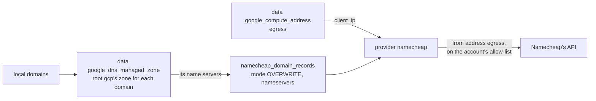

# Root namecheap: the domains' nameservers

**Decision**: `terraform/namecheap` delegates each domain registered at Namecheap to the Cloud DNS zone that [root gcp](gcp.md#dns) keeps for it, by setting the domain's nameservers to the zone's name servers. Nobody sets a nameserver by hand. Pipeline `apply` applies it on every merge to `main`, after `gcp` ([Terraform plan and apply](../designs/terraform-plan-apply.md)). This page documents every domain it delegates; other repositories link it rather than repeat them.

| File | Resources |
| --- | --- |
| `domains.tf` | `local.domains`; data sources `google_compute_address.egress` and, per domain, `google_dns_managed_zone.this`; per domain, `namecheap_domain_records.this` |
| `imports.tf` | every domain, which was registered and delegated by hand first |

State: prefix `namecheap` in `arikkfir-devops`. Providers: `namecheap/namecheap` 2.9 and `hashicorp/google` 8.5, for the data sources only. The Namecheap provider takes the account's user name, as both its user and its API user, and its API key from `NAMECHEAP_USER_NAME`, `NAMECHEAP_API_USER` and `NAMECHEAP_API_KEY`: the pipelines read them from secrets `infra-namecheap-api-user` and `infra-namecheap-api-key` ([Secret Manager](gcp.md#secret-manager)). Its `client_ip` is address `egress`, the cluster's one egress IP ([network](gcp.md#network)).

## Domains

| Domain | Zone (root gcp) | Serves |
| --- | --- | --- |
| `octomaton.dev` | `octomaton-dev` | Octomaton's webhook and Go import page |
| `cobranch.dev` | `cobranch-dev` | Nothing yet: Cobranch's open-source product, which anyone installs |
| `cobranch.app` | `cobranch-app` | Nothing yet: Cobranch's hosted service |

Each is in mode `OVERWRITE`: the domain's nameservers are exactly its zone's four, without their trailing dots. `prevent_destroy` keeps every one, since destroying it would put the domain back on Namecheap's own DNS.

To add a domain registered at Namecheap, first add its zone to `local.dns_zones` in `terraform/gcp/dns.tf`, in a pull request of its own. Then add the domain to `local.domains` in `terraform/namecheap/domains.tf`: that pull request's plan reads the zone, so the zone must already exist. The import block adopts the domain's current settings, and the plan shows its nameservers changing to the zone's.

## Namecheap's API

- The owner turns API access on for the account, in Namecheap's dashboard (Profile, Tools, API Access), and adds address `egress` to the account's allow-list of IPs (`terraform -chdir=terraform/gcp output -raw egress_ip`). Namecheap answers only calls from an IP on that list, so this root runs where the pipelines run, in the cluster.
- The key is the account's only one, and Namecheap has no read-only kind: it can change or transfer every domain of the account. Plans hold it too, as the owner decided ([security](../designs/terraform-plan-apply.md#security-and-failure-modes)).
- Three domains take a plan or an apply a handful of calls, well under the 20 a minute that the provider paces itself to.

## Decisions

| Decision | Why | Rejected |
| --- | --- | --- |
| A root of its own | One root per target. A failing Namecheap stops no apply of `gcp` | The resources in root gcp, beside the zones |
| Name servers read from the zones | Root gcp creates the zones, and reading them keeps one source | A copy of each zone's name servers; root gcp's outputs through `terraform_remote_state`, which reads its whole state |
| `client_ip` is address `egress` | Every call from the cluster leaves through it, and Namecheap admits only the IPs on the allow-list | The provider's own detection through `api.ipify.org`, a third party every plan would depend on |
| Mode `OVERWRITE` | The domain's nameservers are exactly its zone's, as the provider recommends for nameservers | `MERGE`, which keeps nameservers set by hand beside them |
| Pull request plans hold the key | A change to a domain's delegation shows in its pull request before a merge applies it. Octomaton never runs a fork's pull request (owner, [ENG-222](https://linear.app/arikkfir/issue/ENG-222)) | Planning this root only in `apply`; a narrower key, which Namecheap doesn't offer |

## Security and failure modes

- **The key.** Any code a pull request runs as `ci-infra-plan` can read it, so any branch of `infra`, Dependabot's included, could change or transfer every domain of the account. The owner accepted this ([Terraform plan and apply](../designs/terraform-plan-apply.md#security-and-failure-modes)).
- **Namecheap's API down, or address `egress` off the allow-list.** The `namecheap` task fails, in pull requests' `Continuous Integration` and in `Apply`; no other root's task waits on it, and the nameservers stay as they were.
- **A new egress IP.** If root gcp ever replaces address `egress`, every call is refused until the owner allow-lists the new one.
- **Propagation.** Resolvers can take up to a day to follow a nameserver change.
- **DNSSEC.** This root doesn't manage it, and the zones don't sign: keep it off at Namecheap, since a DS record there for an unsigned zone breaks the domain.
- **Drift.** A nameserver changed in Namecheap's dashboard shows in the next plan, and `Apply` reverts it.

## Running it by hand

Namecheap admits only address `egress`, so no workstation can plan or apply this root. One command runs by hand, once, before the first plan: `terraform -chdir=terraform/namecheap init`. It creates the root's empty state in `arikkfir-devops`, which `ci-infra-plan` can only read; without it, every plan fails on writing `namecheap/default.tflock`. While the pipelines can't run, set a domain's nameservers in Namecheap's dashboard to the four that root gcp's output for it prints (`octomaton_dev_name_servers`, `cobranch_dev_name_servers`, `cobranch_app_name_servers`), without their trailing dots. The next `Apply` finds them already set.
